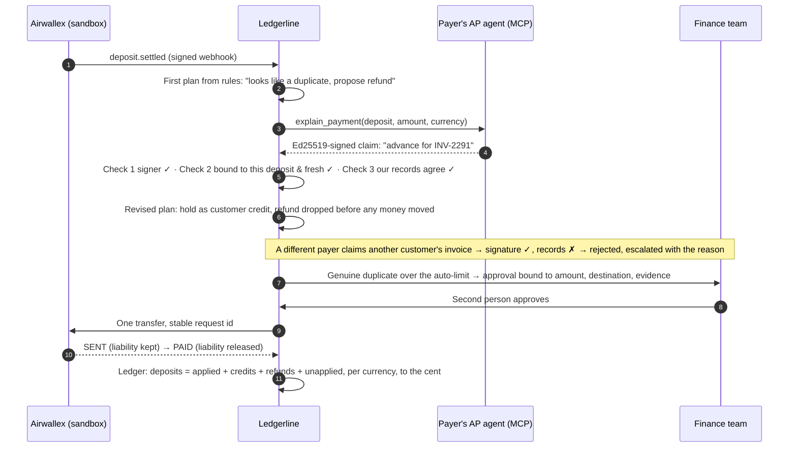
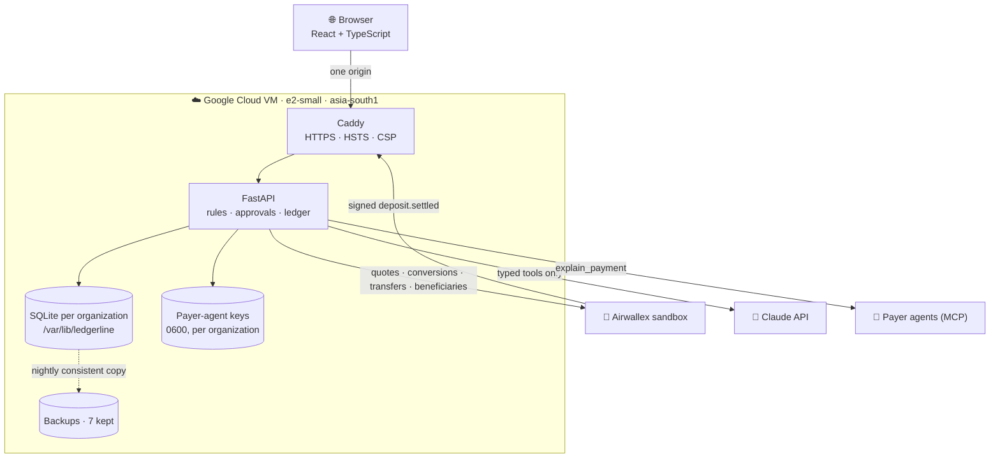

<p align="center">
  <a href="https://35-207-220-110.sslip.io"></a>
</p>

<p align="center">
  <a href="https://35-207-220-110.sslip.io"></a>
  <a href="https://35-207-220-110.sslip.io/#/architecture"></a>
  <a href="docs/JUDGE_QUICKSTART.md"></a>
</p>

<p align="center">
  
  
  
  
  
  
  
</p>

<h3 align="center">Resolve unclear incoming payments using verified evidence,<br>with every decision explained and every cent accounted for.</h3>

---

## ⚡ In thirty seconds

A finance team receives money in USD, EUR and GBP. Some payments match an invoice cleanly; many don't: no reference, a bank fee shaved off, a customer who paid twice, the wrong currency. Today one person chases each of those by email, for days.

**Ledgerline turns that into a decision engine.** Rules in code settle the clean cases. For the unclear ones it asks **the payer's own accounts-payable agent** what the money was for, over MCP, and treats the signed answer as **a claim to verify, not a fact**. Only after three checks pass does it act: settle an invoice, hold credit, request the exact balance, convert only the FX shortfall, or propose a refund, which above your limit **a second person must approve**. Claude reads emails and PDFs when there is no agent, but it can only *suggest*. It never moves money.

| | |
|:--|:--|
| 🎯 **For** | small multi-currency companies on Airwallex Global Accounts |
| 🧠 **Agentic part** | agent-to-agent evidence over MCP, verified before trust; Claude as a typed, advisory reader |
| 🛡️ **Safety** | money rules in code · four-eyes · duplicate lock · stable request ids · pause switch · SENT ≠ PAID |
| ✅ **Proof** | 297 backend tests · 13 browser tests · 5-job CI · 2,127 random payments with 0 allocation disagreements · live Airwallex refund SENT → PAID |

---

## 🎬 The story the demo tells



Every payment shows this as a **decision path**: received → first plan → evidence → checks → decision → approval → settlement → accounting.

| Apparent duplicate becomes credit | Signed but false claim is rejected | Approval bound to the exact scope |
|:--:|:--:|:--:|
|  |  |  |

---

## 🚀 Try it (five minutes)

1. Open **https://35-207-220-110.sslip.io** → **Get started** → any name and email (nothing is emailed) → **Practice company**.
2. **Payments → DEP-1005 → Ask payer's agent**: the duplicate becomes verified advance credit.
3. **Payments → DEP-1004 → Ask payer's agent**: a correctly signed claim for another customer's invoice is rejected.
4. **Read remittance…** on DEP-1004: paste an email or upload a PDF; Claude proposes, a person decides.
5. **Walkthrough**: FX for the EUR bill, the refund a person approves, bank SENT then PAID, and the scorecard.

Your organization is isolated from every other one. A practice company uses made-up data and a simulated bank. To use your own company instead, choose **My company**, then connect your Airwallex sandbox keys under Settings: they are checked with Airwallex first, stored encrypted per organization, and can only reach the Airwallex test environment.

**When cash is short:** Treasury → *What to pay first* ranks bills due soon by priority, then due date, and decides each one: fund, convert only the shortfall, defer to a date you allowed, or escalate. New cash reopens only the decisions it changes, and each change is audited. Deciding moves no money.

**Not done yet:** live-money Airwallex access, and connecting a customer's own hosted payer agent (payer agents currently run on this server).

---

## 📊 Measured, not claimed

| What | Result | Where |
|:--|:--|:--|
| Reference company (6 payments) | **4** settled with no person · **1** approval · **1** escalation with its reason · **0** double payments · ledger balanced | [EVALUATION](docs/EVALUATION.md) |
| Randomized companies | **50** companies · **2,127** payments · **0** allocations disagreeing with an independent reference model | [EVALUATION](docs/EVALUATION.md) |
| Accuracy harness | **250** companies · **64,215** checks · **0** mismatches | [ACCURACY_REPORT](docs/ACCURACY_REPORT.md) |
| Live Airwallex sandbox (Google Cloud host) | signed webhooks booked once · beneficiary validated and created · current FX rates · refund approved by a second member, **one** transfer, SENT → PAID, liability released only at PAID | [INTEGRATION_EVIDENCE](docs/INTEGRATION_EVIDENCE.md) |
| Live Claude | text and PDF remittances read by `claude-opus-5-5`; a planted prompt injection was ignored and flagged; nothing applied | [INTEGRATION_EVIDENCE](docs/INTEGRATION_EVIDENCE.md) |
| Release | CI 5/5 jobs · public smoke 32/32 · data survives restart, VM reboot and redeploy (8/8 each) | [Acceptance report](docs/FULL_APPLICATION_ACCEPTANCE_REPORT.md) |

What is **not** measured yet: real customers' payment mix, hours saved, adoption. Those need a pilot.

---

## 🏗️ Architecture



One VM serves the website, the API and the data. Explore it in 3D at [`#/architecture`](https://35-207-220-110.sslip.io/#/architecture) (drag or use the arrow keys).

<details>
<summary><b>Code map</b></summary>

```
backend/ledgerline/
  api/              security (session → membership → role → organization), routes, auth, OAuth
  control.py        users, organizations, memberships, sessions, invitations, throttling
  tenancy.py        one isolated context per organization; sandbox allow-list checked on every use
  webhooks.py       HMAC over x-timestamp + raw body, skew limit, event-id dedupe
  matching.py       deterministic first plan        reconcile.py   plans, buckets, revisions
  evidence.py       the three checks on claims       claude_reader.py  typed proposals, budgets, PDF, usage
  payouts.py        scoped approvals, four-eyes      treasury.py    reserves, single-use quotes
  ledger.py         double entry, conservation       providers/     local simulated bank, Airwallex sandbox
  payer_agents/     MCP server + Ed25519 keys        beneficiaries.py, sandbox_receipts.py
frontend/src/       React views: Inbox, Payments, Approvals, Evidence, Treasury, Ledger, Customers, Activity, Team, Settings, Walkthrough, Architecture
deploy/vm/          setup.sh, update.sh, Caddyfile, systemd units, backup.py
scripts/            smoke_deploy.py, evaluate.py, accuracy_run.py
```
</details>

---

## 🛡️ Money rules the code enforces

| Rule | What it prevents |
|:--|:--|
| Rules, limits, reserves and conservation live in Python and per-organization policy | a prompt deciding amounts |
| Integer minor units; bad precision, negative, boolean, non-finite amounts refused | rounding drift and malformed input |
| Reference + identified payer + currency, never amount alone | allocating money to the wrong customer |
| A signed answer is a claim: registered key of the *asked* customer, bound to this deposit and amount, fresh, records agree | forged, replayed or false agent answers |
| Approvals bind deposit version, amount, currency, destination and evidence hash; any change invalidates | approving one thing and paying another |
| Proposer ≠ approver | one person moving money alone |
| One live refund per deposit, stable request ids, lookup before any retry | paying twice after a timeout |
| SENT keeps the liability; only PAID releases it | treating an unsettled transfer as done |
| Pause stops every money-out action; matching continues | runaway actions during an incident |
| Claude output is advisory and schema-validated; it can never authorise money | AI moving money |

<details>
<summary><b>Roles</b></summary>

| | Viewer | Operator | Owner |
|:--|:--:|:--:|:--:|
| Read everything, export evidence | ✓ | ✓ | ✓ |
| Record/import payments, customers, invoices, resolve, ask agents, read remittances, propose returns | | ✓ | ✓ |
| Approve/reject (not own proposals), execute, quotes, conversions, pause | | ✓ | ✓ |
| Resume, policy, team, settings, sandbox tools, opening balances | | | ✓ |

Every rule is enforced by the API; the UI only hides what you cannot do.
</details>

<details>
<summary><b>Security posture</b></summary>

- scrypt password hashes; 12+ characters with upper, lower and a digit; login errors never reveal whether an account exists; 5 failures per email or IP in 15 minutes → 429.
- Session cookie HttpOnly, Secure, SameSite=Strict, Path=/api; only its SHA-256 is stored; 2 h idle and 12 h absolute expiry; logout and password change revoke server-side.
- CSRF token on every mutation plus Origin allow-list; forged `X-Forwarded-For` cannot change the throttling identity.
- HSTS, strict CSP, `X-Frame-Options: DENY`, `nosniff`; only ports 22/80/443 reachable.
- Airwallex, Anthropic and Google secrets are server environment variables only; webhook secrets are write-only; nothing secret in the browser bundle, Git, logs or exports.
- Sign in with Google (OIDC + PKCE, never auto-linked to a password account by email). Apple is intentionally not offered.
</details>

---

## 🖼️ Screens

| | |
|:--:|:--:|
|  |  |
|  |  |
|  |  |

<sub>Captured from a real run on a synthetic company (`frontend/e2e/screenshots.spec.ts`). Desktop and 375 px layouts; every page meets WCAG AA contrast.</sub>

---

## 🧪 Run it yourself

<details>
<summary><b>Locally (Python 3.12+, Node 22.12+)</b></summary>

Linux or macOS:

```bash
python3 -m venv backend/.venv && backend/.venv/bin/pip install -r backend/requirements-lock.txt
```

```bash
(cd frontend && npm ci && npm run build)
```

```bash
cd backend && .venv/bin/python -m ledgerline
```

Windows:

```bash
powershell -ExecutionPolicy Bypass -File scripts/setup.ps1
```

```bash
powershell -ExecutionPolicy Bypass -File scripts/start.ps1
```

Open http://127.0.0.1:8000 → **Create an organization**. No default accounts. Data lives in `backend/var/`.

```bash
powershell -ExecutionPolicy Bypass -File scripts/test.ps1
```

```bash
backend\.venv\Scripts\python scripts\evaluate.py --seeds 50
```
</details>

<details>
<summary><b>Configuration (all optional)</b></summary>

| Variable | Purpose |
|:--|:--|
| `AIRWALLEX_CLIENT_ID`, `AIRWALLEX_API_KEY` | Airwallex sandbox (server-wide) |
| `LEDGERLINE_SANDBOX_ORGS` | the only organizations allowed to use them |
| `ANTHROPIC_API_KEY` | Claude reader (`claude-opus-5-5`, daily budgets per organization and server) |
| `GOOGLE_CLIENT_ID`, `GOOGLE_CLIENT_SECRET` | Sign in with Google |
| `LEDGERLINE_PUBLIC_URL`, `LEDGERLINE_ALLOWED_ORIGINS`, `LEDGERLINE_COOKIE_SECURE`, `LEDGERLINE_TRUSTED_PROXY_HOPS` | public origin, CSRF allow-list, secure cookie, proxy hops |
| `LEDGERLINE_DATA_DIR`, `LEDGERLINE_REQUIRE_PERSISTENT_MOUNT` | data location and a guard against ephemeral storage |

Without keys the app runs fully on the simulated bank and labelled offline rules.
</details>

<details>
<summary><b>Deploy, back up, troubleshoot</b></summary>

```bash
sudo bash deploy/vm/setup.sh <host> self <commit>
```

```bash
sudo bash /opt/ledgerline/src/deploy/vm/update.sh <commit>
```

Caddy (automatic HTTPS) → systemd service as an unprivileged user → SQLite on the persistent disk. A nightly timer makes consistent backups (7 kept); an isolated restore test passed. `scripts/smoke_deploy.py <url> --save/--verify` checks 32 behaviours and proves persistence across restart, reboot and redeploy. Full guide, backup/restore and troubleshooting table: [DEPLOYMENT](docs/DEPLOYMENT.md).
</details>

---

## 📚 Documents

| For | Read |
|:--|:--|
| Judges | [JUDGE_QUICKSTART](docs/JUDGE_QUICKSTART.md) · [DEMO_SCRIPT](docs/DEMO_SCRIPT.md) |
| Evidence | [INTEGRATION_EVIDENCE](docs/INTEGRATION_EVIDENCE.md) · [EVALUATION](docs/EVALUATION.md) · [ACCURACY_REPORT](docs/ACCURACY_REPORT.md) |
| Acceptance | [FULL_APPLICATION_ACCEPTANCE_REPORT](docs/FULL_APPLICATION_ACCEPTANCE_REPORT.md) · [HACKATHON_REQUIREMENTS_MATRIX](docs/HACKATHON_REQUIREMENTS_MATRIX.md) |
| Operations | [DEPLOYMENT](docs/DEPLOYMENT.md) · [DEPLOYMENT_HANDOFF](docs/DEPLOYMENT_HANDOFF.md) |
| Origin | [Accepted proposal](docs/original-proposal.txt) · [SUBMISSION_DRAFT](docs/SUBMISSION_DRAFT.md) |

## ⚠️ Honest limits

- Payer agents are simulations (real MCP and signatures); real customers' agents would be discovered at onboarding.
- Airwallex hosted payment links are refused for this sandbox account (`configuration_error`, which Airwallex attributes to account-region support); Ledgerline keeps a labelled draft and never invents a URL.
- Deposit discovery is owner-triggered, not a scheduled poller; Airwallex's dashboard replay did not produce a second delivery, so duplicate rejection is proven by tests.
- One VM, backups on the same disk, Free Trial credit until 28 Jan 2027; no email delivery, password reset, SSO/MFA or billing.

<p align="center"><sub>Built for the Airwallex Agentic Banking Hackathon · sandbox and synthetic data only · no real money</sub></p>
