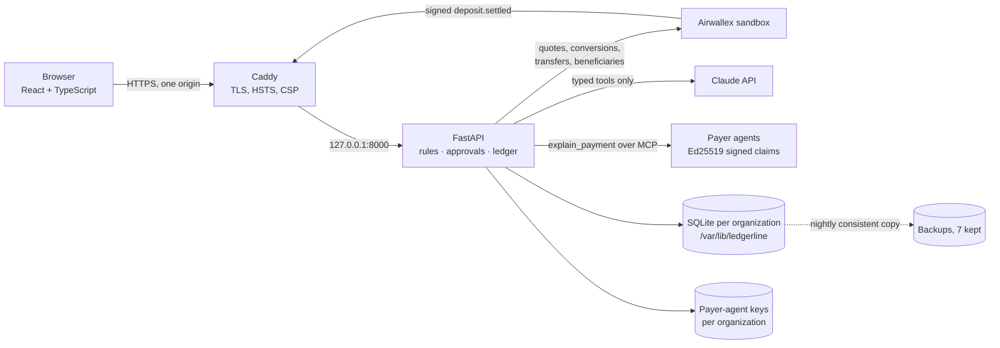

# Ledgerline

**When a payment doesn't match, my agent asks the payer's agent, and verifies the answer before any money moves.**

### Live app: **https://35-207-220-110.sslip.io**
Always on (one Google Cloud VM, Mumbai). Click **Get started**, choose **Sample data**, and the guided walkthrough runs the whole story in about four minutes. Interactive 3D architecture: [https://35-207-220-110.sslip.io/#/architecture](https://35-207-220-110.sslip.io/#/architecture). Judges: [JUDGE_QUICKSTART](docs/JUDGE_QUICKSTART.md).

Agentic Banking Hackathon, **Treasury & Ops** track. Hackathon build: sandbox and synthetic data only, no real money.


---

## The problem

A 12-person software company in Singapore bills customers in the US, the EU and the UK into Airwallex Global Accounts. One finance person matches incoming payments by hand every week:

- references say `INV 2231 + 2240`, or nothing at all;
- a bank fee turns a 5,000 invoice into 4,970;
- a customer pays twice, or pays a EUR invoice in USD;
- each unclear payment means an email and a two-day wait, while cash sits in the wrong currency and next week's bills fall due.

Getting it wrong costs money and goodwill: refund a "duplicate" that was really an advance and you annoy a good customer; chase a short payment that was only a bank fee and you look careless.

## What Ledgerline does

For every settled deposit, rules in code pick one action: clean match, fee write-off within tolerance, partial payment with a payment request for the exact balance, duplicate (refund or credit, the evidence decides), wrong currency, or unknown. When the rules cannot decide, Ledgerline:

1. **asks the payer's own AP agent** over MCP (`explain_payment`) and gets an Ed25519-signed claim;
2. **verifies it like evidence, not truth**: signed by the key that customer registered, bound to this exact deposit and still fresh, and our records agree (invoice exists, belongs to that customer, amount fits);
3. **revises its plan** (for example, a refund is dropped before any money moves because the "duplicate" was an advance), or **escalates to a person with the reason**;
4. **acts under control**: refunds above the auto-limit need a second person, every money-out has a stable request id and a duplicate lock, a pause switch stops all money-out, and **SENT is not final**: the liability is released only at PAID.

If there is no agent, **Claude** reads the remittance email or PDF and must answer through one of four typed tools. Its output is stored as advisory evidence and can never authorise money. Treasury keeps a reserve per currency and converts only the shortfall for bills due soon, using single-use quotes.

### Measurable outcome (reference scenario, reproducible on the live app)

| | Result |
|---|---|
| Deposits | 6 (USD, EUR, GBP) |
| Settled with no human | **4**, each with its evidence and plan history |
| Approvals by a person | 1 (the over-limit refund, four-eyes) |
| Escalations | 1, with the reason ("INV-2253 belongs to another customer") |
| Double payments | **0** |
| Ledger | balanced per currency to the cent |

Accuracy harness: 250 randomized synthetic companies driven through the real API, **64,215 checks, 0 mismatches** against an independent reference model ([report](docs/ACCURACY_REPORT.md)).

## Screenshots

| | |
|---|---|
|  |  |
|  |  |
|  |  |
|  |  |

All screenshots come from a real run of the app on a synthetic sample company (`frontend/e2e/screenshots.spec.ts`).

## What is real and what is simulated

| Part | In this build | Evidence |
|---|---|---|
| Accounts, organizations, roles, sessions, tenant isolation | **Real, tested** | scrypt hashes, HttpOnly SameSite=Strict cookie, CSRF token, throttling, expiry, server-side logout; one database per organization |
| Matching, ledger, approvals, locks, pause, FX reserves | **Real, tested** | integer minor units, journaled, per-currency conservation |
| Payer agents (`explain_payment`) | **Real MCP protocol, simulated agents** | MCP stdio subprocess (official `mcp` SDK); six local customer agents with their own Ed25519 keys; one is deliberately dishonest |
| Bank, default ("Local workspace") | **Simulated** | per-organization simulated bank with fault injection; labelled everywhere |
| Airwallex sandbox | **Verified live (sandbox)** for the operator organization only | signed `deposit.settled` webhooks on the Google Cloud host (HTTP 200, each booked once); a refund approved by a second member and completed SENT→PAID as exactly one transfer on the Google Cloud host (30 Oct); deposits and an FX conversion verified earlier; current rates, beneficiary schema/validation and deposit listing verified 29 Oct. Judge organizations always use the simulated bank. See [INTEGRATION_EVIDENCE](docs/INTEGRATION_EVIDENCE.md) |
| Claude evidence reader | **Verified live** | 29 Oct, through the browser: text and PDF remittances read by `claude-opus-5-5`, schema-validated, stored as advisory evidence; an embedded prompt injection was ignored and flagged; nothing applied. Token usage is recorded per call |
| Email | **Not sent** | invitation links are copied; balance requests are drafts |

## Architecture



One Google Cloud VM (e2-small, Ubuntu 24.04, asia-south1) runs everything: Caddy terminates HTTPS (sslip.io name for the static IP) and proxies to the FastAPI process, which also serves the built React app. There is no other runtime dependency. Interactive version: [`#/architecture`](https://35-207-220-110.sslip.io/#/architecture).

```
backend/ledgerline/
  api/            security (session → membership → role → organization), routes, auth, OAuth
  control.py      users, organizations, memberships, sessions, invitations, throttling
  tenancy.py      one isolated context per organization; sandbox allow-list checked at every use
  webhooks.py     HMAC over x-timestamp + raw body, skew limit, event-id dedupe
  matching.py     deterministic first plan          reconcile.py  plans, buckets, revisions
  evidence.py     the three checks on signed claims claude_reader.py  typed proposals, budgets, PDF
  payouts.py      scoped approvals, four-eyes, locks treasury.py  reserves, single-use quotes
  ledger.py       double entry, conservation        providers/{local,airwallex}.py
  payer_agents/   MCP server + Ed25519 keys         beneficiaries.py, sandbox_receipts.py
```

**Why database-per-organization:** isolation is structural. A query in one organization's context cannot reach another organization's rows because they are in a different file; the only path between them is the session → membership check, re-read on every request.

### Money rules the code enforces

- **Rules live in code**, never in a prompt: tolerances, limits, reserves and conservation are Python and per-organization policy.
- **Integer minor units.** Amounts are converted with `Decimal`; extra precision, negative, non-finite or boolean values are refused.
- **No amount-only matching.** Reference + identified payer + currency, or nothing.
- **A signed answer is a claim.** Registered key of the *asked* customer; bound to this deposit, amount and a bounded validity window; our records agree; replays refused.
- **Approvals bind scope** (deposit + version, amount, currency, destination, evidence version and hash). Any change invalidates the approval. The proposer cannot approve.
- **No double payout.** One live refund per deposit, stable request ids, lookup by request id before any retry after an ambiguous response.
- **SENT is not final.** Liability released only on PAID; failures never debit cash.
- **FX only on SETTLED**, sell amount reserved at booking, pending proceeds never spendable, each quote used once.
- **Pause** blocks refunds, retries and conversions; matching keeps running.

### Roles

| | Viewer | Operator | Owner |
|---|---|---|---|
| Read everything, export evidence JSON | ✓ | ✓ | ✓ |
| Record/import payments, customers, invoices, adjustments, resolve exceptions, ask agents, read remittances, propose returns | | ✓ | ✓ |
| Approve/reject refunds (not your own proposals), execute, quotes, conversions, obligations, pause | | ✓ | ✓ |
| Resume, policy, team, organization and integration settings, sandbox tools, opening balances | | | ✓ |

Every rule is enforced by the API; the UI only hides what you cannot do.

## Run it locally (Windows)

Needs Python 3.12+ (developed on 3.14) and Node.js 22.12+.

```bash
powershell -ExecutionPolicy Bypass -File scripts/setup.ps1
```

```bash
powershell -ExecutionPolicy Bypass -File scripts/start.ps1
```

Open http://127.0.0.1:8000 and choose **Create an organization**. There are no default accounts. Data lives in `backend/var/` (delete it to start fresh). Development mode with hot reload: `python -m ledgerline` in `backend/` and `npm run dev` in `frontend/` (port 5173, proxied to 8000).

Tests and build:

```bash
powershell -ExecutionPolicy Bypass -File scripts/test.ps1
```

## Configuration

All optional; without them the app runs fully on the simulated bank and the offline rules reader. Secrets are server environment variables only (see `backend/.env.example`), never in the browser bundle or Git.

| Variable | Purpose |
|---|---|
| `AIRWALLEX_CLIENT_ID`, `AIRWALLEX_API_KEY` | Airwallex sandbox (server-wide) |
| `LEDGERLINE_SANDBOX_ORGS` | the only organization ids allowed to use those credentials; everyone else stays on the simulated bank |
| `ANTHROPIC_API_KEY` | Claude reader (`LEDGERLINE_CLAUDE_MODEL`, default `claude-opus-5-5`; per-organization and server daily budgets) |
| `GOOGLE_CLIENT_ID`, `GOOGLE_CLIENT_SECRET` | Sign in with Google (OIDC + PKCE). Apple is intentionally not offered |
| `LEDGERLINE_PUBLIC_URL`, `LEDGERLINE_ALLOWED_ORIGINS`, `LEDGERLINE_COOKIE_SECURE`, `LEDGERLINE_TRUSTED_PROXY_HOPS` | public origin, CSRF origin allow-list, secure cookie, proxy hops for client IPs |
| `LEDGERLINE_DATA_DIR`, `LEDGERLINE_REQUIRE_PERSISTENT_MOUNT` | data location and a guard that refuses to start on ephemeral storage |

In Settings an owner of an allow-listed organization switches the bank to *Airwallex sandbox*, saves the receiving global account ids and the webhook secret, registers the organization's webhook URL in Airwallex, creates refund beneficiaries (validated by Airwallex first), and can run **Find missed deposits** as the webhook fallback.

## Deploy (Google Cloud VM, single host)

The `deploy/vm` kit installs everything on one Ubuntu 24.04 VM: Python 3.14 with a locked dependency set, Node 22 for the frontend build, a systemd service running as an unprivileged user, Caddy with automatic HTTPS, firewall rules for 80/443, and a nightly backup timer.

```bash
sudo bash deploy/vm/setup.sh 35-207-220-110.sslip.io self <commit>
```

Then put keys in `/etc/ledgerline/ledgerline.env` (root-owned, mode 640) and `sudo systemctl restart ledgerline`. Updates deploy an exact commit and rebuild the frontend:

```bash
sudo bash /opt/ledgerline/src/deploy/vm/update.sh <commit>
```

`scripts/smoke_deploy.py <url>` runs 32 public checks (health and storage, CSP, cookie flags, CSRF and foreign-origin refusal, unauthenticated refusal, a partial payment and idempotent re-entry, signed MCP evidence and the cross-customer rejection, the treasury conversion, four-eyes, cross-organization isolation, logout replay, conservation) and `--save`/`--verify` proves accounts, data, the refund lifecycle and signing keys survive a restart, reboot or redeploy. Details and the current deployment record: [DEPLOYMENT](docs/DEPLOYMENT.md), [DEPLOYMENT_HANDOFF](docs/DEPLOYMENT_HANDOFF.md).

### Backups and restore

`ledgerline-backup.timer` runs nightly at 03:15 UTC: SQLite's online backup API makes consistent copies of every database plus the payer-agent key files into `/var/lib/ledgerline/backups/<timestamp>/`, keeping 7. To restore, stop the service, copy a snapshot's files back into `/var/lib/ledgerline/` (owner `ledgerline`), start the service. An isolated restore test (integrity check, row counts equal to live, a second instance serving the copy) passed on 29 Oct. **Limitation:** backups are on the same disk as the data, so they protect against bad writes, not disk loss; a disk snapshot schedule or off-VM copy would be the next step.

### Troubleshooting

| Symptom | Check |
|---|---|
| Site not reachable | `systemctl status caddy ledgerline`; `journalctl -u ledgerline -n 50`; ports 80/443 open in the VPC firewall |
| 502 from Caddy | the app is not listening on 127.0.0.1:8000; `curl http://127.0.0.1:8000/api/health` on the VM |
| Service refuses to start | `LEDGERLINE_REQUIRE_PERSISTENT_MOUNT` guard or a missing env value; the journal names it |
| Sign-in loops | `LEDGERLINE_PUBLIC_URL`/`ALLOWED_ORIGINS` must equal the browser origin exactly; cookies need HTTPS |
| Airwallex option disabled | credentials missing, or the organization id is not in `LEDGERLINE_SANDBOX_ORGS` |
| Webhook rejected | the Airwallex webhook secret in Settings must match the dashboard; timestamps outside the skew window are refused |
| Claude reads refused | daily budget reached (resets 00:00 UTC) or no `ANTHROPIC_API_KEY`; PDFs need Claude |

## Tests

- **Backend** (`backend/tests`): unit, API, real stdio MCP subprocess, threaded concurrency, SaaS boundaries, webhooks, judge safety, proposal capabilities; the PostgreSQL adapter suite runs in CI on PostgreSQL 17.
- **Accuracy harness**: 250 seeds, 64,215 checks, 0 mismatches; 12 seeds also run in pytest.
- **Evaluation** (`scripts/evaluate.py`, [report](docs/EVALUATION.md)): the six documented cases reach their documented outcomes; 50 randomized companies, 2,127 payments, 0 allocations disagreeing with the reference model; share resolved automatically, by a person, or waiting with a reason.
- **Browser** (`frontend/e2e`, Playwright on Microsoft Edge): sign-up/sign-out, home page, Apple absent, roles, cross-organization isolation, 375px layout, dialogs and focus, the payment decision path.
- **CI**: five GitHub Actions jobs (Linux and Windows backend, PostgreSQL 17, frontend build, browser E2E).
- Current results and dates: [FULL_APPLICATION_ACCEPTANCE_REPORT](docs/FULL_APPLICATION_ACCEPTANCE_REPORT.md).

## Known limitations

- Airwallex credentials are server-wide and reserved for one operator organization; judge organizations use the simulated bank by design.
- Hosted payment links: the sandbox refused `POST /pa/payment_links/create` (HTTP 401); Ledgerline keeps an honest draft and never invents a URL.
- Airwallex's dashboard "resend" did not produce a second delivery, so provider-side replay is proven only by signed local tests and dedupe, not by a real duplicate delivery.
- Payer agents are local simulations; a real deployment would discover each customer's MCP endpoint and key at onboarding.
- No email delivery, password reset, SSO/MFA or subscription billing.
- Backups are on the VM's own disk. The Free Trial credit ends 28 Jan 2027; after that the VM stops unless billing is upgraded.
