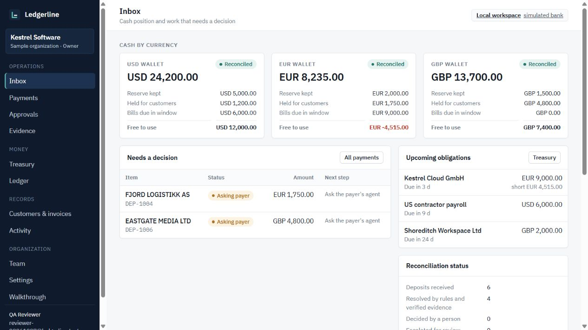

# Ledgerline

**When a payment doesn't match, my agent asks the payer's agent — and verifies the answer before any money moves.**

Ledgerline is a multi-tenant reconciliation application for small international companies that bill in USD, EUR and GBP. Deposits are matched by deterministic rules. When a deposit is ambiguous, Ledgerline asks the payer's own accounts-payable agent (over MCP) what the money was for, verifies the signed answer with three checks, revises its plan, and then applies a credit, a refund, a payment request or an FX conversion — under role-based approvals, a duplicate lock and a pause switch, with the ledger balanced per currency to the cent.

Built for the Agentic Banking Hackathon (Treasury & Ops). **Hackathon build, not production-ready, no real money.** Sample organizations use synthetic data; the reference company "Northbeam Software Pte. Ltd." and its customers are fictional.



Verification as of 28 Oct 2026: **215 backend tests** pass locally (8 PostgreSQL-only tests are skipped without a database URL; the whole suite last passed on PostgreSQL 17 in CI at `8a079a7`), **9 browser E2E tests**, strict frontend build, **32/32 live checks** through the public URL (`scripts/smoke_deploy.py`), and **0 npm audit findings**. Earlier independent review: [report](docs/INDEPENDENT_REVIEW.md). Live deployment details: [DEPLOYMENT_HANDOFF](docs/DEPLOYMENT_HANDOFF.md).

---

## What is real and what is simulated

| Part | In this build | Notes |
|---|---|---|
| Accounts, organizations, roles, sessions | **Real, tested** | scrypt password hashes, HttpOnly SameSite=Strict session cookie, CSRF token, login throttling, idle/absolute expiry, server-side logout. |
| Tenant isolation | **Real, tested** | One database, simulated bank and payer-agent key set per organization; every request is bound to the member's organization only. |
| Matching rules, ledger, approvals, locks, pause, FX reserve logic | **Real, tested** | Integer minor units, serialized writer transactions (SQLite `BEGIN IMMEDIATE`; on PostgreSQL a transaction-scoped advisory lock per schema). |
| Payer agents (`explain_payment`) | **Real MCP protocol, simulated agents** | An MCP server subprocess (stdio) using the official `mcp` SDK. The six customer agents are local simulations with their own Ed25519 keys; one is deliberately dishonest. |
| Bank (transfers, FX, deposits) — default | **Simulated bank ("Local workspace")** | A per-organization "bank" (SQLite file locally, PostgreSQL schema when hosted) with fault injection. No network, no money. Shown as a *Local workspace* badge; simulated actions are labelled. |
| Airwallex sandbox adapter | **Implemented, not executed against the sandbox** | Endpoints and payloads follow the official API reference (checked 2026-10-27). Tested only against a mocked HTTP transport; no credentials were available. Settings → *Run readiness check* performs a real sandbox login when credentials exist and reports exactly what happened. |
| Webhooks | **Real verification** | Per-organization URL and secret; HMAC-SHA256 over `x-timestamp` + raw body; skew limit; event-id dedupe in the same transaction; documented flat `deposit.settled` shape. |
| Claude evidence reader | **Optional** | With `ANTHROPIC_API_KEY`, Claude must answer through strict typed proposal tools. Without it, offline rules produce the same shape, labelled "Claude not invoked". Advisory only; never moves money. |
| Email (invitations, balance requests) | **Not sent** | Owners copy one-time invitation links; balance requests are recorded as drafts. |

## Prerequisites (Windows)

- Windows 10/11 with PowerShell
- Python **3.12+** on PATH (developed with 3.14.7)
- Node.js **22.12+** (or 24 LTS) and npm (developed with Node 24.20 / npm 11.19)

## Run it locally

```bash
powershell -ExecutionPolicy Bypass -File scripts/setup.ps1
```

```bash
powershell -ExecutionPolicy Bypass -File scripts/start.ps1
```

Open http://127.0.0.1:8000 and choose **Create an organization**. Pick *Sample data* to get the synthetic reference company with six received payments (and the optional walkthrough), or *An empty workspace* to start from scratch. There are **no default accounts or passwords**.

To create an owner from the command line instead (for example with sign-up disabled):

```bash
cd backend && .venv\Scripts\python -m ledgerline.manage create-owner --email you@company.test --org "Company" --sample
```

The password is prompted interactively (or read from `LEDGERLINE_BOOTSTRAP_PASSWORD` for scripted local setups); only its hash is stored.

Development mode (hot-reload UI on :5173 proxied to the API on :8000):

```bash
cd backend && .venv\Scripts\python -m ledgerline
```

```bash
cd frontend && npm run dev
```

Tests and build:

```bash
powershell -ExecutionPolicy Bypass -File scripts/test.ps1
```

Live smoke test against a running server (creates throwaway accounts with random passwords):

```bash
backend\.venv\Scripts\python scripts/smoke_live.py
```

All state lives in `backend/var/` (`control.sqlite3` plus `orgs/<org_id>/`). Stop the server and delete that folder to start fresh. `python -m ledgerline.manage migrate` applies pending migrations to the control plane and every organization.

## Using it

- **Sign in / organizations** — one person can belong to several organizations and switch from the menu at the top of the sidebar, or create a new one there.
- **Team** — owners invite people by email with a role and copy the one-time link (valid 3 days); change roles; remove members (access ends immediately). The last owner cannot be removed or demoted.
- **Inbox** — per-currency cash, what needs a decision, upcoming obligations, recent activity.
- **Payments** — search, filter and page through received funds. *Record payment* or *Import CSV* for statement lines (labelled *manually recorded, not bank-verified*; idempotent per statement reference). Open a payment for its decision history (initial vs revised plan), evidence and checks, postings and audit; ask the payer's agent, read a remittance (paste any text), resolve an escalated payment (apply to the payer's own invoice or hold as credit, partial allowed), or propose a return to sender.
- **Approvals** — exact scope (amount, currency, destination, deposit version, evidence version, scope hash) and checks; approve/reject behind a confirmation; execute; track `processing → sent → paid` (SENT is not final). The proposer of a refund cannot approve it.
- **Evidence** — payer answers with the three checks and the before/after plan.
- **Treasury** — settled cash, reserves, held funds, bills in window, FX reservations and pending FX in (forecast, never spendable); obligations (add your own); opening balances (once per currency); single-use expiring quotes.
- **Ledger** — per-currency conservation, five checks, per-deposit buckets, double-entry journal.
- **Customers & invoices** — create and edit customers (remitter names must be unambiguous across customers); create invoices; edit description and due date; amounts change only through audited **adjustments** (credit note, additional charge) or **void** (unpaid invoices only).
- **Activity** — searchable, paginated audit trail; *Download evidence JSON*.
- **Settings** — pause money-out, organization name, bank mode, Airwallex global accounts and webhook secret (write-only), this organization's webhook URL, readiness check, policy, password change.
- **Walkthrough** (sample organizations only) — the reference scenario step by step.

### Roles

| | Viewer | Operator | Owner |
|---|---|---|---|
| Read everything, export evidence JSON | ✓ | ✓ | ✓ |
| Record/import payments, customers, invoices, adjustments, resolve exceptions, ask agents, propose returns | | ✓ | ✓ |
| Approve/reject refunds (not your own proposals), execute, quotes, conversions, obligations | | ✓ | ✓ |
| Pause money-out | | ✓ | ✓ |
| Resume money-out, policy, team, organization and integration settings, opening balances, reset sample data | | | ✓ |

Every rule above is enforced by the API; the UI only hides what you cannot do.

## Architecture

```
                 ┌──────────────────────────── browser (React + TS, Vite) ───────────────────────────┐
                 │ Sign in · Inbox · Payments · Approvals · Evidence · Treasury · Ledger · Team · …   │
                 └───────────────┬────────────────────────────────────────────────────────────────────┘
                                 │ /api  HttpOnly session cookie + X-CSRF-Token, Origin / Sec-Fetch-Site checks
 Airwallex ── deposit.settled ──►│  /api/webhooks/airwallex/{org_id}  (HMAC per organization)
 (sandbox) ◄─ transfers / FX ────┤ FastAPI
                                 │  api/security.py   session → membership → role → organization context
                                 │  control.py        users, organizations, memberships, sessions, invitations, throttling
                                 │  tenancy.py        one isolated context per organization
                                 │  migrations.py     versioned control-plane and tenant migrations
                                 │  ─────────────── per-organization domain (unchanged safeguards) ───────────────
                                 │  webhooks · matching · reconcile · evidence · payouts · treasury · ledger · workspace
                                 │  payer_agents/ (MCP stdio) · claude_reader · providers/{local, airwallex}
                                 └──► backend/var/control.sqlite3
                                      backend/var/orgs/<org_id>/{ledgerline.sqlite3, local_bank.sqlite3, payer_agents/}
                                      (hosted: PostgreSQL schemas <prefix>_control, <prefix>_t_<org_id>, <prefix>_b_<org_id>;
                                       payer-agent keys encrypted in the organization's schema)
```

**Why database-per-organization:** isolation is structural. A query in one organization's context cannot reach another organization's rows because they are in a different file (hosted: a different schema, pinned by the connection's `search_path`); the only path between them is the session → membership check, which is re-read from the control plane on every request. Tests prove cross-organization reads, approvals, switching and webhook signing are refused.

Financial rules the code enforces (unchanged from the single-tenant build, all regressions still passing):

- **Money rules live in code.** Tolerances (absolute and relative), limits, reserves and conservation checks are in Python and per-organization policy — never in a prompt.
- **Integer minor units.** API amounts are converted with `Decimal`; extra precision, negative, non-finite or boolean values are rejected.
- **No amount-only matching.** Reference + identified payer + currency, or nothing.
- **A signed answer is a claim.** Registered key of the *asked* customer; bound to this exact deposit, amount and a positive, bounded validity window; our records agree. Replays refused. Action still limited by code and approvals.
- **Approvals bind scope** (deposit + version, amount, currency, destination, evidence version and hash). Execution rechecks inside the transaction; any change — including editing the customer's refund account — invalidates the approval. Four-eyes: proposer ≠ approver.
- **No double payout.** One live refund per deposit (unique index), UUIDv5 request IDs, submission lease, lookup by request ID before any retry after an ambiguous response.
- **SENT is not final.** Liability released only on PAID; immediate failures never debit cash.
- **FX only on verified SETTLED**, sell amount reserved at booking, pending proceeds never spendable, missing lookups keep the reservation.
- **No edited money history.** Invoice amounts change only through journaled adjustments; opening balances once per currency.
- **Pause** blocks refunds, retries and conversions, persists, and leaves matching running.

## Security posture

- Passwords: scrypt (n=2^14, r=8, p=1, 16-byte salt); minimum 12 characters with upper, lower and a digit. Login errors do not reveal whether an account exists.
- Throttling: 5 failures per email or per IP in 15 minutes → HTTP 429 with `Retry-After`.
- Sessions: random 256-bit token in `ll_session` (HttpOnly, SameSite=Strict, Path=/api, Secure when `LEDGERLINE_COOKIE_SECURE=1`); only its SHA-256 is stored. 2-hour idle and 12-hour absolute expiry; logout and password change revoke server-side.
- CSRF: per-session token in `X-CSRF-Token` on every mutation, plus Origin allow-list and `Sec-Fetch-Site: cross-site` refusal.
- Headers: `X-Content-Type-Options`, `X-Frame-Options: DENY`, `Referrer-Policy`, `Cache-Control: no-store` on the API.
- Secrets: Airwallex and Anthropic keys are server environment variables only; organization webhook secrets are stored server-side and never returned. Simulated payer agents' private keys are under `backend/var/` (gitignored).
- Logs: one line per API request with method, path, status, duration, organization and user — no bodies or secrets.

### Deployment notes

`python -m ledgerline` refuses to bind a non-loopback address unless `LEDGERLINE_COOKIE_SECURE=1`, i.e. you terminate TLS in front of it. Hosted mode stores everything in PostgreSQL (`LEDGERLINE_DATABASE_URL`, one schema per organization; see [DEPLOYMENT](docs/DEPLOYMENT.md)); it has only been run as a single server instance. For anything beyond a demo you would also want: email delivery for invitations, SSO/MFA, a secrets manager for per-organization Airwallex credentials, backups, and rate limiting at the proxy. None of that is included.

## Integration setup

**Airwallex sandbox** (optional): set `AIRWALLEX_CLIENT_ID` and `AIRWALLEX_API_KEY` on the server. In Settings an owner switches the organization to *Airwallex sandbox*, enters global account ids per currency and the webhook secret from the Airwallex dashboard, and registers this organization's webhook URL (via a tunnel for local runs). Refund destinations must then be sandbox **beneficiary IDs** (beneficiary creation is not automated). Endpoints used: `authentication/login` (token cached until 2 minutes before `expires_at`), `simulation/deposit/create` (currency comes from the global account), `fx/quotes/create`, `fx/conversions/create` + `GET fx/conversions[/{id}]`, `transfers/create` + `GET transfers?request_id=`, `simulation/transfers/{id}/transition`, `pa/payment_links/create`. No `x-api-version` header is sent. The settled-deposit webhook carries no payer, so Ledgerline records payer and reference when it creates each sandbox simulation.

**Sign in with Google / Apple** (optional): OpenID Connect authorization-code flow, implemented in `backend/ledgerline/oidc.py` and `api/oauth_routes.py`. The buttons appear on sign-in, sign-up and invitation screens, and stay disabled until the server has credentials (see `backend/.env.example`).
- Google: create an OAuth client (Web application) and register `http://localhost:8000/api/auth/oauth/google/callback` (or your `LEDGERLINE_PUBLIC_URL`). Set `GOOGLE_CLIENT_ID` and `GOOGLE_CLIENT_SECRET`. PKCE is used.
- Apple: create a Services ID with Sign in with Apple, a key (.p8), and register `https://<your host>/api/auth/oauth/apple/callback`. Apple only accepts HTTPS redirects and returns by cross-site form POST, so run behind TLS with `LEDGERLINE_COOKIE_SECURE=1`. Set `APPLE_CLIENT_ID`, `APPLE_TEAM_ID`, `APPLE_KEY_ID` and `APPLE_PRIVATE_KEY_PATH`. The client secret is a 5-minute ES256 JWT signed per request.
- Server-side checks: single-use state bound to the starting browser by an HttpOnly cookie (10-minute expiry), nonce, ID-token RS256 signature against the provider's published keys, issuer, audience, expiry, and a verified email for new accounts. A provider login is **never merged into an existing password account by email**, because password sign-ups do not verify email ownership. Instead, sign in with the password and use Settings → Sign-in methods → Connect. Accounts created through a provider have no password; the last sign-in method cannot be disconnected. Invited users can sign in with a provider and then join in one click if the address matches.

**Claude** (optional): set `ANTHROPIC_API_KEY` (model defaults to `claude-opus-5-5`, override with `LEDGERLINE_CLAUDE_MODEL`). Used only by *Read remittance*. Calls are budgeted per organization (`LEDGERLINE_CLAUDE_DAILY_LIMIT`, default 25) and server-wide (`LEDGERLINE_CLAUDE_SERVER_DAILY_LIMIT`, default 200) per UTC day; each attempt is reserved before dispatch and counts even if it fails.

## Four-minute demo script

1. **Sign up (0:00).** Create an organization with *Sample data*. The Inbox shows three wallets, EUR short for the hosting bill due in 3 days, and six received payments: two matched (split reference; a 15 EUR bank fee written off), one short payment with a drafted balance request, three asking the payer.
2. **Team (0:30).** Invite an operator; open the link in a private window to join. Note the role table.
3. **Payments → Dunmore (0:50).** "Possible duplicate, refund proposed". *Ask payer's agent*: signed answer over MCP, three checks pass, refund dropped before any money moved, credit toward the March invoice.
4. **Fjord (1:30).** No reference; Fjord's agent claims Brightwave's invoice. **Check 3 fails**, escalated with the reason. *Resolve* never offers another customer's invoice and the API refuses it anyway.
5. **Treasury (2:10).** Quote USD→EUR for exactly the shortfall; convert; USD stays above reserve.
6. **Approvals (2:40).** Eastgate's agent confirms a true duplicate over the auto-limit. Approve the exact scope, execute, simulate *sent* (still pending on the ledger) then *paid*.
7. **Ledger (3:30).** Each currency balanced to the cent. Switch to a second, empty organization: none of this data is visible.

## Requirements matrix

| Requirement | Where | Evidence |
|---|---|---|
| Sign-in, onboarding, roles, logout, sessions | `control.py`, `api/security.py`, `api/auth_routes.py`, `views/Auth.tsx` | `test_saas.py` (signup/login/logout replay, cookie flags, password policy, throttling, idle + absolute expiry, password change) |
| Tenant isolation on reads, mutations, exports, webhooks | `tenancy.py`, per-org webhook URL | `test_organizations_cannot_see_or_touch_each_other`, `test_webhook_secret_is_per_organization`, `scripts/smoke_live.py` |
| Role enforcement in the API, four-eyes | `require_role`, `payouts.decide` | `test_viewer_is_read_only`, `test_operator_works_but_cannot_govern`, `test_proposer_cannot_approve_own_refund`, `test_role_changes_and_removal_take_effect_immediately` |
| Invitations | `control.invite/accept_invitation` | `test_invitation_single_use_and_expiry` |
| Migrations | `migrations.py`, `manage migrate` | `test_migrations_recorded_and_legacy_tenant_upgraded` |
| CRUD without the walkthrough; adjustments not edits; CSV import | `workspace.py` | `test_empty_workspace_full_workflow`, `test_voided_invoice_can_never_be_paid`, `test_csv_import_is_idempotent_per_row`, `test_customer_edit_invalidates_bound_approval`, `test_workspace.py` |
| Six-deposit scenario | `scenario.py`, `demo.py` | `test_full_demo_scorecard`, `test_guided_demo_over_api…` |
| Matching rules incl. 970/1000 stays partial | `matching.py` | `test_matching.py` |
| MCP + Ed25519 + three checks (tamper, expiry, wrong deposit/amount, cross-customer, replay, zero/negative window) | `payer_agents/`, `evidence.py` | `test_evidence.py`, `test_integrations.py::test_explain_payment_over_stdio_mcp`, regressions #5 |
| Approval binding, duplicate lock, ambiguous retries, SENT not final, failed refunds keep cash | `payouts.py` | `test_payouts.py`, regressions #3 |
| FX finality, reservations, pending not spendable, missing lookup holds | `treasury.py` | `test_treasury_ledger.py`, regressions #1, #2, #9, #10 |
| Webhook HMAC, skew, dedupe, malformed, documented shape | `webhooks.py` | `test_api_webhooks.py`, regressions #6, #7 |
| Sandbox adapter behaviour (mocked) | `providers/airwallex.py` | `test_integrations.py` |

## Tests

`backend/tests` — **174 tests**: unit, API integration, a real stdio MCP subprocess, threaded concurrency, and SaaS boundaries.

**Randomized accuracy harness** (`backend/tests/accuracy_harness.py`, full run `backend\.venv\Scripts\python scripts\accuracy_run.py --seeds 250 --walkthroughs 25`, report in `docs/ACCURACY_REPORT.md`). Each seed builds a synthetic company and drives it through the real API: opening balances, customers (some with payer agents), invoices, credit notes, extra charges and voids. It then sends statement lines typed singly or imported as CSV, with invalid rows and re-imports mixed in, and has an operator resolve escalated payments. A reference model written from the product rules predicts every outcome, and the harness compares it against what the API reports: each invoice balance and status, each payment's category, status, payer and buckets, import counts, wallet cash, credits and unapplied money, ledger checks, the audit trail, and organization isolation. The harness is itself tested: three bugs planted in memory (fee tolerance doubled, matching on amount alone, unapplied off by one cent) were each caught. 12 seeds and the walkthrough also run inside `pytest`. `test_review_regressions.py` has one section per independent review finding. Frontend: `npm run build` (strict `tsc` + Vite) and `npm run e2e` (Playwright browser suite, 9 tests, uses the installed Microsoft Edge; set `E2E_CHANNEL=chromium` after `npx playwright install chromium` elsewhere). Recorded results: `docs/CLAUDE_HANDOFF.md` and `docs/INDEPENDENT_REVIEW.md`.

## Known limitations

- Airwallex adapter not executed against the live sandbox; beneficiary creation not automated; Airwallex API credentials are server-wide rather than per organization.
- Sign in with Google / Apple is tested only against fake providers that sign real RS256 tokens (`tests/test_oauth.py`); it has not been run against real Google or Apple accounts. Apple needs HTTPS. Provider-only accounts cannot add a password yet.
- No email delivery (invitation links are copied manually), no enterprise SSO (SAML) or MFA, no password reset flow (an owner can re-invite; `manage create-owner` bootstraps).
- Payer agents are local simulations; real deployments would discover each customer's MCP endpoint and key at onboarding.
- The hosted PostgreSQL mode has been run as one Render instance only; several instances have not been tested.
- FX uses fixed synthetic rates in local workspaces. Paying obligations is out of scope.
- No subscription billing (explicitly out of scope).
