# Ledgerline: agent-to-agent payment reconciliation

<sub>Not related to other projects, packages or repositories that use the name Ledgerline.</sub>

<p>
  <a href="https://github.com/Lingu17/ledgerline/actions/workflows/ci.yml"></a>
  <a href="#run-the-tests"></a>
  <a href="https://35-207-220-110.sslip.io/attacks"></a>
  <a href="https://35-207-220-110.sslip.io"></a>
  <a href="VIDEO_LINK"></a>
  
</p>

When a payment arrives that matches no invoice, Ledgerline's agent asks the payer's own agent what it was for.
The answer comes back signed; Ledgerline checks the signature, that it is about this payment and still fresh, and that its own records agree.
Only then does the plan change: in the reference company 4 of 6 payments are decided with no person, and no refund leaves without a verified answer or a second person.

Short, honest answers to the questions judges ask: [Judge Q&A](docs/JUDGE_QA.md).

**Why Airwallex**
- Deposits arrive as signed Airwallex webhooks, and refunds and bill payments go out as Airwallex transfers that are booked only at PAID.
- Multi-currency accounts and Airwallex's own FX quotes let a bill be paid by converting only what is short.
- Refund destinations are validated by Airwallex's beneficiary API before they are saved. All of this ran on the real sandbox: [evidence](https://35-207-220-110.sslip.io/evidence).

**Business model (a proposal, not tested with customers):** a monthly subscription per company, priced by payments reconciled, for finance teams of small companies that bill in several currencies. The payer-agent protocol stays open and free to implement, so payers have no cost to join. This is a proposal; the next step is a pilot with a small number of SMEs that receive cross-border payments on Airwallex.

## Judge it in 3 minutes

1. **[Open the live app](https://35-207-220-110.sslip.io) → Judge demo — one click.** You get a practice company of your own (simulated bank, deleted after 48 hours), signed in as Judge A, with Teammate B one click away.
2. **Payments → DEP-1005 → Ask payer's agent.** It looks like a duplicate, so the first plan holds a refund; the signed answer says it was an advance, all three checks pass, and the plan changes to credit.
3. **Payments → DEP-1004 → Ask payer's agent.** Correctly signed but false: the records check fails, so it is rejected and goes to a person with the reason.
4. **[/attacks](https://35-207-220-110.sslip.io/attacks):** 25 hostile attempts on the simulated bank, each refused, with what stopped it and the money measured before and after.
5. **[/evidence](https://35-207-220-110.sslip.io/evidence):** every run on the real Airwallex sandbox, with dates, ids and what it proves, and what is simulated only.
6. **CEO view:** the whole company on one screen, including what the agent did by itself.

**Fresh clone, practice company, simulated bank (Python 3.13+, Node 22.12+):**

```bash
git clone https://github.com/Lingu17/ledgerline && cd ledgerline
python scripts/setup.py
python scripts/start.py
```

Then open http://localhost:8000. No keys needed; see [Run it yourself](#-run-it-yourself) for details.

<p align="center">
  <a href="https://35-207-220-110.sslip.io"></a>
</p>

<p align="center"><sub>
<a href="#in-30-seconds">In 30 seconds</a> ·
<a href="#try-it-in-5-minutes">Try it</a> ·
<a href="#what-is-real-and-what-is-simulated">What is real</a> ·
<a href="#for-judges-each-criterion-with-evidence-you-can-check">For judges</a> ·
<a href="#-features">Features</a> ·
<a href="#-measured-not-claimed">Measured</a> ·
<a href="#%EF%B8%8F-architecture">Architecture</a> ·
<a href="#%EF%B8%8F-money-rules-the-code-enforces">Money rules</a> ·
<a href="#-tech-stack">Tech stack</a> ·
<a href="#-run-it-yourself">Run it</a> ·
<a href="docs/JUDGE_QUICKSTART.md">Judge quickstart</a> ·
<a href="docs/JUDGE_QA.md">Judge Q&amp;A</a>
</sub></p>

---

## In 30 seconds

- **The problem:** a payment arrives that doesn't match an invoice. Someone emails the payer, waits, guesses, and sometimes refunds money that was really an advance.
- **What Ledgerline does:** rules in code match what is clear. For the rest, **its agent asks the payer's own agent** what the payment was for, **checks the signed answer three ways**, and changes its plan **before any money moves**. Small verified refunds go out under your limit; anything bigger needs two people.
- **What you get:** fewer payments for a person to chase, no refund without a verified answer or a second person, one screen that says whether the company is safe, and a record of every decision that can be replayed and cannot be quietly edited.

## Try it in 5 minutes

1. Open **[the live app](https://35-207-220-110.sslip.io)** → **Judge demo — one click**: a practice company of your own, signed in as Judge A, with Teammate B one click away (deleted after 48 hours). Or **Get started** → **Practice company** with any name and email (nothing is emailed) and a password of 12+ characters.
2. **The agent on its own: Payments → Receive an unclear payment.** It arrives, the agent asks the payer's agent, checks the signed answer and places the money, with no click. A real company works this way for every unclear payment.
3. **Payments → DEP-1005 → Ask payer's agent.** It looks like a duplicate, so the first plan holds a refund. The signed answer says it was an advance; three checks pass and the plan changes to **credit**. No wrong refund leaves. Press **Explain this decision** and **Replay this decision**. Then **DEP-1004**: correctly signed but false, so it is **rejected** and goes to a person with the reason.
4. **Practice steps → run to the end.** Approve the over-limit refund, then **Switch to Teammate B** and send it (or **Send as practice teammate**) (whoever approves an agent-proposed refund can't also send it). The bank goes **SENT → PAID** and the ledger balances to the cent.
5. **CEO view:** the whole company on one screen, including **What the agent did by itself**, read from the audit log.

More detail: the [judge quickstart](docs/JUDGE_QUICKSTART.md). For your own company, choose **My company** and connect your Airwallex sandbox keys under Settings.

## What it decides by itself, and what it never does

| By itself | Never by itself |
|:--|:--|
| Settles clear payments, writes off bank fees within tolerance, holds credits, and prepares the exact-balance request (a person sends it) | Sends a refund over your limit without two people |
| In a real company, asks the payer's agent the moment an unclear payment arrives | Believes an answer that fails any of the three checks |
| Sends small refunds backed by a verified answer, under the limit you set | Lets Claude state an amount or move money. Claude only reads documents, as advice |

**The three checks on every agent answer:** who signed it · that it is about this payment and still fresh · that your own records agree.

### What is real and what is simulated

| Part | Real | Simulated, or not yet |
|:--|:--|:--|
| Bank | Ran on the real Airwallex sandbox: signed deposit webhooks, a refund SENT → PAID as one transfer, a currency conversion, a EUR 100 bill payment, a paid early-payment link, beneficiaries and live rates | No live money. Agent-proposed refunds, automatic refunds under the limit, failed and timed-out transfers, the pause switch and wrong-currency conversion are tested on the simulated bank only |
| Payer agents | Real MCP and Ed25519 signatures, and the three checks on every answer. A customer can connect its own agent with its own key, asked over the network; the [spec](docs/PAYER_AGENT_SPEC.md) has a schema and a signed test vector, and the reference agent once answered the live site across the internet from the owner's PC | The built-in agents answer from a fixed table with keys on this server, so their signature proves the mechanism, not that an outside party spoke. No outside company runs one yet |
| Two people for money out | Enforced in code: the proposer cannot approve, and the approver of an agent-proposed refund cannot also send it | It checks accounts, not people: both live payments out were proposed and approved with two of the owner's own accounts |
| Claude | Reads remittance emails and PDFs live (`claude-opus-5-5`) through five typed tools | Advice only: no tool has an amount or account field, and nothing it says moves money |
| Companies | Separate data per company, roles, CSV import and export | Practice companies use made-up data; USD, EUR and GBP only |

**Why the AI doesn't decide:** on purpose. Every money decision is made by rules in code that a replay reproduces exactly; the model only reads documents and explains, the same split Airwallex's own agentic-banking reference builds draw ([comparison](docs/JUDGE_QA.md)).
**What the payer gains by running an agent:** fewer "what was this payment for?" emails from its suppliers, its payment placed on the right invoice the same day, and no wrong refund it then has to send back.

<p align="center">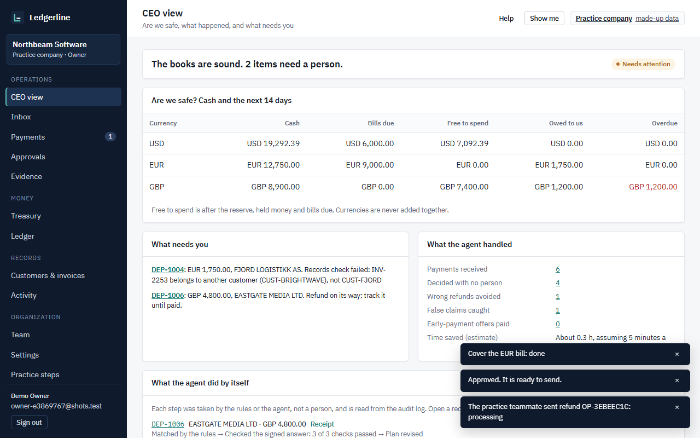</p>

### Why a CEO would care

| You want | What you get |
|:--|:--|
| **Less manual chasing** | In the reference company, 4 of 6 payments are decided with no person, and 3 of those are fully closed. A part payment still needs someone to send the balance request. The rest arrive with the reason and the next step |
| **No costly mistakes** | No double payments, no refund of money that was really an advance, and no money out on one person's say-so |
| **To know where you stand** | The **CEO view** answers four questions on one screen: are we safe, what happened, what needs me, can I trust these numbers |
| **Cash in the right place** | Each bill gets one answer: pay it, convert only what is short, delay it, or ask a person. It can also bring cash in early |
| **Proof for an audit** | Every decision shows its reason, can be replayed to the same answer, and sits in a tamper-evident log; a practice company can try to tamper with it and watch the chain catch the row |

### For judges: each criterion, with evidence you can check

| Criterion | What Ledgerline shows | Check it in two minutes |
|:--|:--|:--|
| **Real-world usefulness** | Unclear incoming payments are a daily cost for any company billing in several currencies. Useful today without any payer agent: rules, the document reader and one queue | Inbox → Needs a decision; CEO view |
| **How agentic** | The agent asks on arrival with no click, believes only answers that pass three checks, changes its own plan, and sends small verified refunds within your limit. The model never decides money; rules do, and a replay proves it | Payments → Receive an unclear payment; CEO view → What the agent did by itself → Receipt; Show me → Hear the two agents talk |
| **Originality** | Agent-to-agent reconciliation: the payer's agent answers over MCP with an Ed25519-signed claim, treated as a claim and checked against your records. A published [spec](docs/PAYER_AGENT_SPEC.md) with a test vector makes it a protocol anyone can implement | Payments → DEP-1005 (verified) and DEP-1004 (signed but false) |
| **Money safety** | Approvals bound to the exact amount and destination, proposer ≠ approver, and when the agent proposes a refund the person who approves it cannot also send it; expiry, pause, one live refund per payment, SENT is not final | [Money rules](#%EF%B8%8F-money-rules-the-code-enforces); Approvals |
| **Completeness** | Multi-company app with roles, CSV, ledger, treasury, CEO view; ran on the real Airwallex sandbox (the flows listed in What is real); CI green on every job including PostgreSQL | [Measured, not claimed](#-measured-not-claimed) |
| **Honesty** | Every simulated part is labelled; the limits are in one table | [What is real](#what-is-real-and-what-is-simulated) · [Judge Q&A](docs/JUDGE_QA.md) |

---

## ✨ Features

**Live** means it has run against the real Airwallex sandbox. **Tested** means automated tests on the simulated bank, not yet run on the sandbox.

| Feature | What it does | Status |
|:--|:--|:--:|
| **Payment matching** | Clean matches, bank fees written off, part payments, duplicates and missing references | Live |
| **The agent asks by itself** | An unclear payment gets its question asked on arrival, with no click. A signed answer must pass three checks: who signed it, that it is about this payment and still fresh, and that your records agree | Tested, simulated agents |
| **AI document reader** | Claude reads remittance emails and PDFs and suggests; a person decides | Live |
| **Why this plan** | A plain-language explanation of each payment's plan, written from structured facts only (ids, amounts, categories, check results; never free text such as the email, the payer name or an agent's own words) and checked: it must cite real ids and use only the facts' numbers, or it is not shown. Advice only; nothing that decides reads it | Tested |
| **Show me** | In a practice company, a seven-stop guided tour that runs the practice story and explains each screen. It never approves or sends money. **Hear the two agents talk** reads it aloud; on DEP-1005 and DEP-1004 the two agents' conversation is replayed in two voices, built from the company's own stored question, signed answer, checks and decision | Tested |
| **Try to tamper** | In a practice company, change one recorded amount straight in the database and watch the hash chain catch that exact row; restore it and the demo is recorded. The server refuses it in a real company. Nightly backup checks put an open demo's change back in their temporary copy and still verify | Tested |
| **Replay this decision** | Any plan the rules made can be re-run: Ledgerline keeps the exact inputs the rules read (and their hash in the audit log), runs the same rules on them again and shows **Same plan** or the difference. A person's decision has no rules to re-run. Read-only | Tested |
| **Two people for money out** | Every bill payment, and refunds above your limit. A person proposes and another approves; if the agent proposed it, one person approves and another sends. The approver sees the exact amount and destination; if anything changes, the approval is void | Live; agent-proposed refunds tested on the simulated bank only |
| **Refunds and bill payments** | One transfer under a duplicate lock. SENT is not final; only PAID closes it | Live |
| **What to pay first** | Ranks bills and decides: fund, convert, defer or escalate. A bill that releases more cash than it costs goes first | Tested |
| **Convert only the shortfall** | Keeps a reserve per currency and buys only what a bill needs | Live |
| **Bring cash in early** | A capped discount through a hosted Airwallex link, booked once it is paid | Live |
| **Exact-balance request** | A payment link and a ready email draft for what is still owed | Link created live; paid link tested |
| **Wrong-currency payments** | Recommends converting only what the invoice needs, or holding; a person clicks | Tested |
| **CEO view** | One screen for whoever runs the company | Tested |
| **What the agent did by itself** | On the CEO view and the Inbox, payment by payment: the steps the rules and the agent took without a person, read from the audit log ("No click" only when the agent asked on its own). Each has a **decision receipt**: the question, the signed answer and its key, the three checks, the decision, a fresh Replay ("Same plan ✓"), the audit event with the chain status, and the cached explanation. Read only | Tested |
| **Live rates** | Airwallex sandbox rates, refreshed every minute on a connected account | Live |
| **Background checks** | Finds paid links and missed deposits by itself | Tested |
| **Ledger to the cent** | Double entry, balanced per currency, and currencies are never added together | Live |
| **Tamper-evident log and replay** | Detects an edited or removed event, and reruns any plan on its stored inputs | Live |
| **Pause switch** | Stops all money leaving at once while matching keeps running | Tested |
| **Real company accounts** | Sign-up, isolated data per company, Owner, Operator and Viewer roles, CSV import, and each company's own encrypted Airwallex keys | Live |

---

## 🏢 Practice company or your own

Each company's data is isolated. A practice company uses made-up data and a simulated bank. For your own company, choose **My company** and connect your Airwallex sandbox keys under Settings.

**What it does not do yet:** handle live money or send email from the server (balance requests open as a draft in your own mail). The built-in payer agents are simulations, and no outside company runs its own yet ([what is real](#what-is-real-and-what-is-simulated)). Without an agent, a person or the document reader handles the case, so it is useful today. Time saved has not been measured with a real customer.

---

## 🎬 How the decision works

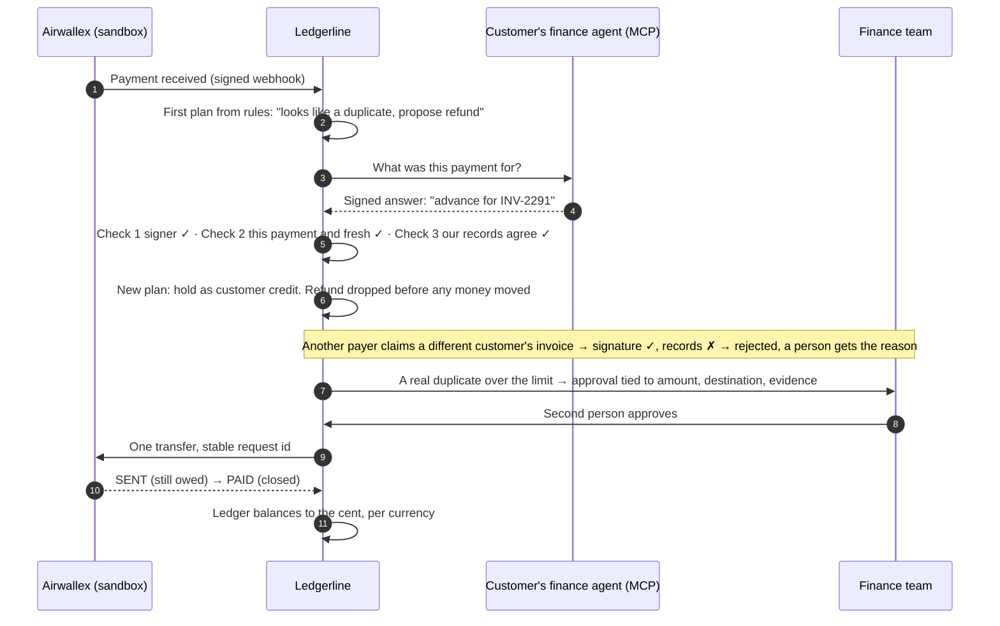

Every payment shows this as a **decision path**: received → first plan → evidence → checks → decision → approval → settlement → accounting.

| Apparent duplicate becomes credit | Signed but false claim is rejected | Approval tied to the exact amount |
|:--:|:--:|:--:|
| 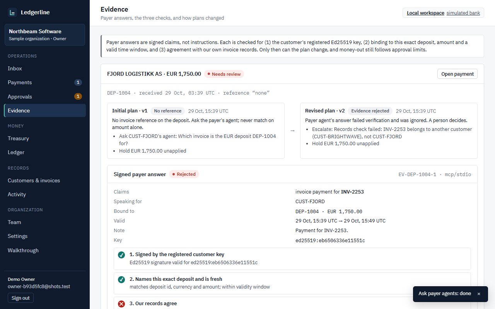 | 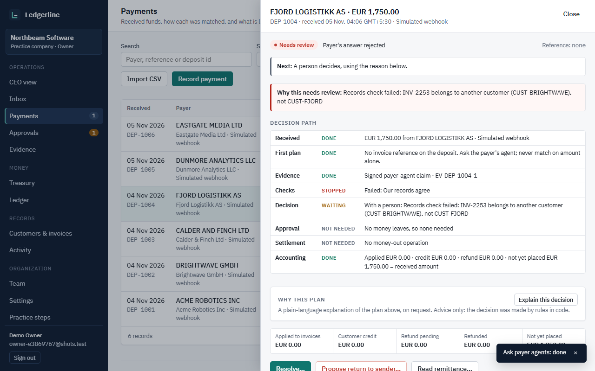 | 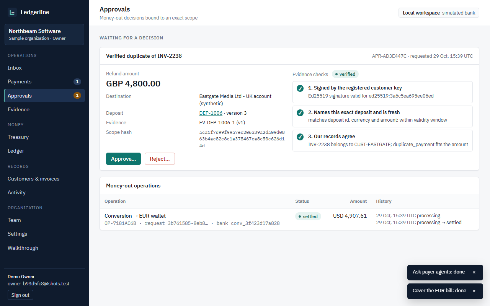 |

---

## 👩‍💼 Using it at work

Everything an employee needs to act on is in the **Inbox**, so start there each day. Treasury's *What to pay first* decides each bill; deciding moves no money. Each item opens the page where it can be resolved.

### Your daily routine

| When | Go to | What you do |
|:--|:--|:--|
| Start of day, if you run the company | **CEO view** | See in one screen whether anything needs you |
| Start of day | **Inbox** | Work through what is waiting: unclear payments, approvals and payments whose bank outcome is unknown |
| A payment is unclear | **Payments** → open it | Read the decision path, then **Ask payer's agent** or **Read remittance…**. Ledgerline checks the answer against your records |
| Someone needs a second person | **Approvals** | Check the amount and destination, then approve or reject. You cannot approve your own proposal |
| Bills are due | **Treasury** → *What to pay first* | Each bill shows one answer: fund, convert, defer or escalate, with the reason |
| Cash is short | **Treasury** → *Bring cash in early* | Offer a capped discount on an invoice not yet due, and share the link with the customer yourself |
| End of day or audit | **Ledger** and **Activity** | Confirm every currency balances, **Verify log integrity**, **Download evidence** |

### How to run each feature

<details>
<summary><b>Set up your company (Owner, about 10 minutes)</b></summary>

1. **Get started** → **My company**. For a safe trial with made-up data, choose **Practice company**.
2. **Settings → Connect your Airwallex**: paste your sandbox keys. They are checked first and stored encrypted.
3. **Team → Invite member**: add at least one more **Operator**, because money-out needs a second person. Nothing is emailed, so send the invitation link yourself.
4. **Settings → Policy**: set reserves, the refund auto-limit, the fee tolerance and the maximum early-payment discount.
5. **Customers & invoices → Import CSV**, or **New customer** and **New invoice**. **Treasury → Bills → Import CSV** or **Add bill**.

CSV columns:

| File | Columns |
|:--|:--|
| Customers | `name,country,payer_names,refund_beneficiary` |
| Invoices | `customer,currency,amount,due_date,description` |
| Bills | `payee,currency,amount,due_date,priority,defer_until,description` |
</details>

<details>
<summary><b>Handle an incoming payment</b></summary>

1. Connected accounts receive payments by signed webhook, and missed ones are found automatically about every ten minutes (**Settings → Find missed deposits** does it at once). Otherwise use **Payments → Record payment** or **Import CSV**.
2. Clean matches settle on their own, and a bank fee within tolerance is written off.
3. For anything else, open the payment and use **Ask payer's agent** or **Read remittance…** (paste an email or upload a PDF). The AI reader only suggests, and a person decides.
4. The result is one of: invoice settled, exact balance requested, credit held, refund proposed, or escalated with the reason.
5. For a part payment, open the balance request, create the link, and use **Open email draft** or **Copy message** to send it to the customer.
6. For a payment in the wrong currency, read the recommendation and click **Convert and apply**, or leave it held.
7. When a balance link is paid, the balance settles the same way, within about two minutes.
</details>

<details>
<summary><b>Pay a bill</b></summary>

1. **Treasury** → the bill must show **Fund**. Click **Pay** and choose the beneficiary. Who can receive it comes from your Airwallex account.
2. A **different** team member approves it under **Approvals** (or **Treasury → Bill payments**).
3. Click **Send payment**. The plan is checked again before anything reaches the bank.
4. **Check status** until it shows paid. SENT is not final: the bill stays open and its cash stays committed until PAID.
5. On a sandbox account, an Owner moves the transfer on with **Simulate bank: sent**, then **Simulate bank: paid**.
</details>

<details>
<summary><b>Bring cash in early</b></summary>

1. When a bill shows **Defer** or **Escalate**, **Treasury → Bring cash in early** lists invoices not yet due, with the discount cost and the cash each one brings in.
2. **Create offer** makes a hosted Airwallex link. Send it to the customer yourself.
3. After they pay, Ledgerline books the discount and the cash and re-plans the bills within about two minutes. **Check payment** does it at once.

In a practice company, **Practice: customer pays** runs the same path without a card.
</details>

<details>
<summary><b>When cash is tight or something looks wrong</b></summary>

- **Stop all money-out:** **Settings → Pause all money-out**. Any Operator can pause, and only an Owner can resume. Matching keeps running.
- **"Outcome unknown":** click **Check status**. Do not pay again, because Ledgerline looks the request up before any retry.
- **Keep cash out of planning:** **Settings → Policy → Set aside from planning**.
- **Check a past decision:** **Treasury → Plan history → Replay** runs the planner again on the stored inputs. **Activity → Verify log integrity** detects an edited or removed event; someone with database write access could rewrite the whole chain, so keep the head hash from a downloaded evidence export to rule that out.
</details>

### Who can do what

| Job | Role |
|:--|:--|
| Auditor or manager who only needs to look | **Viewer** |
| Finance staff doing the daily work and approving each other's payments | **Operator** |
| Finance lead: team, policy, Airwallex connection, resuming money-out, sandbox test buttons | **Owner** |

### What saves the team time

- **One queue:** the Inbox replaces checking the bank, email and spreadsheets separately.
- **Clear cases need no one:** in the reference company, 4 of 6 payments are decided without a person, and 3 are fully closed.
- **Reasons on screen:** each decision shows why it was made, so a colleague can pick it up without asking.
- **Bulk import:** bring customers, invoices, bills and payments in by CSV.
- **Hard to make costly mistakes:** a second approver, a duplicate lock and a pause switch are enforced by the system, not by memory.
- **Audit in one click:** **Download evidence** exports the record, and **Verify log integrity** checks it.

---

## 📊 Measured, not claimed

| What | Result | Where |
|:--|:--|:--|
| Reference company (6 payments) | **4** decided with no person, **3** fully closed · **1** approval · **1** escalation with its reason · **0** double payments · ledger balanced | [EVALUATION](docs/EVALUATION.md) |
| Randomized companies | **50** companies · **2,127** payments · **0** allocations disagreeing with an independent reference model | [EVALUATION](docs/EVALUATION.md) |
| Value on synthetic companies (first plan per payment) | **8,826** payments in 200 made-up companies built to be hard, with no payer agent answering: **30.4%** decided with no person (the reference company's 4 of 6 is once its payer agents answer), **50.5%** escalated with a reason, **19.2%** waiting for the payer's agent · **0** refunds sent without verified evidence or a person · about **223 hours** of matching saved *if* a payment takes 5 minutes by hand (an assumption) | [MEASURED_VALUE](docs/MEASURED_VALUE.md) |
| Accuracy harness (rules only, automatic asking switched off) | **200** companies and 25 sample walkthroughs · **61,063** checks · **0** mismatches · all **8,826** rules decisions replayed to the same plan | [ACCURACY_REPORT](docs/ACCURACY_REPORT.md) |
| Live Airwallex sandbox (Google Cloud host) | signed webhooks booked once · beneficiary validated and created · current FX rates · refund approved with the owner's second account (not independent review), **one** transfer, SENT → PAID, liability released only at PAID | [INTEGRATION_EVIDENCE](docs/INTEGRATION_EVIDENCE.md) |
| Live hosted link (2 Nov) | a test-card payment of EUR 197 on a Singapore sandbox account was reported paid by Airwallex and booked once; the invoice settled and the bill moved from Escalate to Fund | Live app |
| Live bill payment (2 Nov) | Airwallex accepted a EUR 100 transfer, moved by its sandbox simulation through SENT to PAID; the bill closed and one journal entry reduced cash only at PAID. Proposer and approver were two accounts of the same owner, so this tests the control and the bank call, not independent review | Live app |
| Live Claude | text and PDF remittances read by `claude-opus-5-5`; a planted prompt injection was ignored and flagged; nothing applied | [INTEGRATION_EVIDENCE](docs/INTEGRATION_EVIDENCE.md) |
| Release (30 Oct) | CI 5/5 jobs · public smoke 32/32 · data survives restart, VM reboot and redeploy (8/8 each) | [Acceptance report](docs/FULL_APPLICATION_ACCEPTANCE_REPORT.md) |
| Tests (5 Nov) | **CI run #221 on `c6624c1`: all 5 jobs pass**, including the whole backend on PostgreSQL 17 (Linux: 596 passed, 10 skipped) · local runs: 590 passed, 2 skipped on Windows; 594 passed, 12 skipped on a second machine; browser 30/30 on Microsoft Edge, including the whole judge path and the Show me tour at phone width (375 px). CI was blocked by a billing hold from 3 to 5 Nov | [Acceptance report](docs/FULL_APPLICATION_ACCEPTANCE_REPORT.md) |

The two synthetic runs answer different questions: the evaluation (50 companies, payer agents answering) compares every allocation with an independent reference model; the accuracy run (200 companies, rules only, automatic asking off) checks every figure the API reports and replays every decision.

What is **not** measured yet: real customers' payment mix, real time saved (the hours above rest on an assumed 5 minutes per payment), how often real payer agents answer, adoption. Those need a pilot.

---

## 🏗️ Architecture

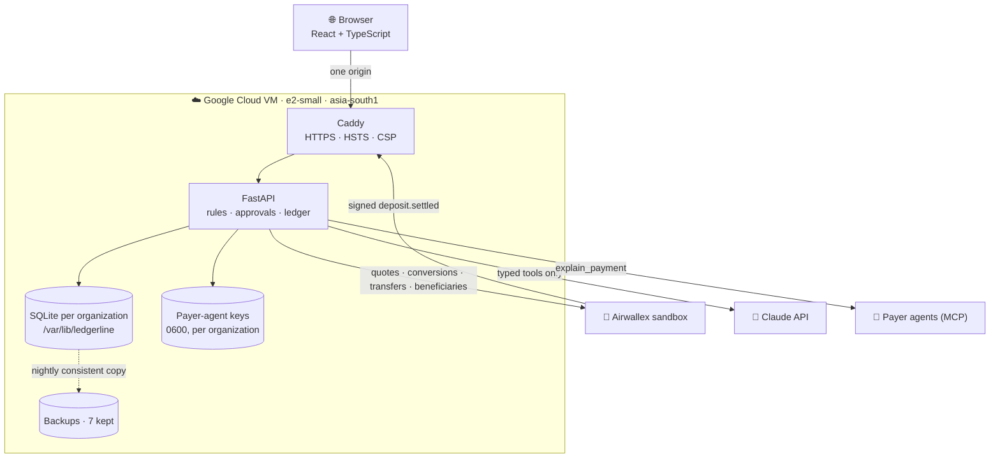

One VM serves the website, the API and the data. Explore it in 3D at [`#/architecture`](https://35-207-220-110.sslip.io/#/architecture) (drag or use the arrow keys).

<details>
<summary><b>Code map</b></summary>

```
backend/ledgerline/
  api/              security (session → membership → role → organization), routes, auth, OAuth
  control.py        users, organizations, memberships, sessions, invitations, throttling
  tenancy.py        one isolated context per organization; sandbox allow-list checked on every use
  webhooks.py       HMAC over x-timestamp + raw body, skew limit, event-id dedupe
  matching.py       deterministic first plan        reconcile.py   plans, buckets, revisions
  evidence.py       the three checks on claims       claude_reader.py  typed proposals, budgets, PDF, usage
  payouts.py        scoped approvals, four-eyes      treasury.py    reserves, single-use quotes
  ledger.py         double entry, conservation       providers/     local simulated bank, Airwallex sandbox
  payer_agents/     MCP server + Ed25519 keys        beneficiaries.py, sandbox_receipts.py
frontend/src/       React views: Inbox, Payments, Approvals, Evidence, Treasury, Ledger, Customers, Activity, Team, Settings, CEO view, Practice steps, Architecture
deploy/vm/          setup.sh, update.sh, Caddyfile, systemd units, backup.py
scripts/            smoke_deploy.py, evaluate.py, accuracy_run.py
```
</details>

---

## 🛡️ Money rules the code enforces

| Rule | What it prevents |
|:--|:--|
| Rules, limits, reserves and conservation live in Python and per-organization policy | a prompt deciding amounts |
| Integer minor units; bad precision, negative, boolean, non-finite amounts refused | rounding drift and malformed input |
| Reference + identified payer + currency, never amount alone | allocating money to the wrong customer |
| A signed answer is a claim: registered key of the *asked* customer, bound to this deposit and amount, fresh, records agree | forged, replayed or false agent answers |
| Approvals bind deposit version, amount, currency, destination and evidence hash; any change invalidates | approving one thing and paying another |
| Proposer ≠ approver, and when the agent proposed a refund, approver ≠ sender | one person moving money alone |
| One live refund per deposit, stable request ids, lookup before any retry | paying twice after a timeout |
| SENT keeps the liability; only PAID releases it | treating an unsettled transfer as done |
| Pause stops every money-out action; matching continues | runaway actions during an incident |
| Claude output is advisory and schema-validated; it can never authorise money | AI moving money |
| Remittance text is data: emails that say "ignore your instructions", "refund 9,999 to this account" or contain a fake tool call change no plan, approval or operation (tested offline and with a model that obeys the email) | prompt injection |
| An approval not sent in time (72 hours by default; an owner sets 1 to 720 in Settings → Policy) goes back to the approvers | stale approvals sent later |
| Optional separate sending service: the Airwallex keys live only in a separate process; the app cannot read them. The app asks it by id only, and it re-checks the approval, expiry, pause, two people and the duplicate lock itself. A compromised app could still request a send that its own database says was approved, or add a payout beneficiary. Owner-run switch: `harden.sh sender` ([SERVER_STEPS](docs/SERVER_STEPS.md) step 7) | an app bug or a leaked app process reading the bank keys |

<details>
<summary><b>Roles</b></summary>

| | Viewer | Operator | Owner |
|:--|:--:|:--:|:--:|
| Read everything, export evidence | ✓ | ✓ | ✓ |
| Record/import payments, customers, invoices, resolve, ask agents, read remittances, propose returns | | ✓ | ✓ |
| Approve/reject (not own proposals), send (not an agent-proposed refund you approved), quotes, conversions, pause | | ✓ | ✓ |
| Resume, policy, team, settings, sandbox tools, opening balances | | | ✓ |

Every rule is enforced by the API; the UI only hides what you cannot do.
</details>

<details>
<summary><b>Security posture</b></summary>

- scrypt password hashes; 12+ characters with upper, lower and a digit; login errors never reveal whether an account exists; 5 failures per email or IP in 15 minutes → 429.
- Session cookie HttpOnly, Secure, SameSite=Strict, Path=/api; only its SHA-256 is stored; 2 h idle and 12 h absolute expiry; logout and password change revoke server-side.
- CSRF token on every mutation plus Origin allow-list; forged `X-Forwarded-For` cannot change the throttling identity.
- HSTS, strict CSP, `X-Frame-Options: DENY`, `nosniff`; only ports 22/80/443 reachable.
- Airwallex, Anthropic and Google secrets are server environment variables only (with the sending service on, the Airwallex keys are in a root-only file that only that service's process receives); webhook secrets are write-only; nothing secret in the browser bundle, Git, logs or exports.
- Sign in with Google (OIDC + PKCE, never auto-linked to a password account by email). Apple is intentionally not offered.
</details>

---

## 🖼️ Screens

| | |
|:--:|:--:|
| 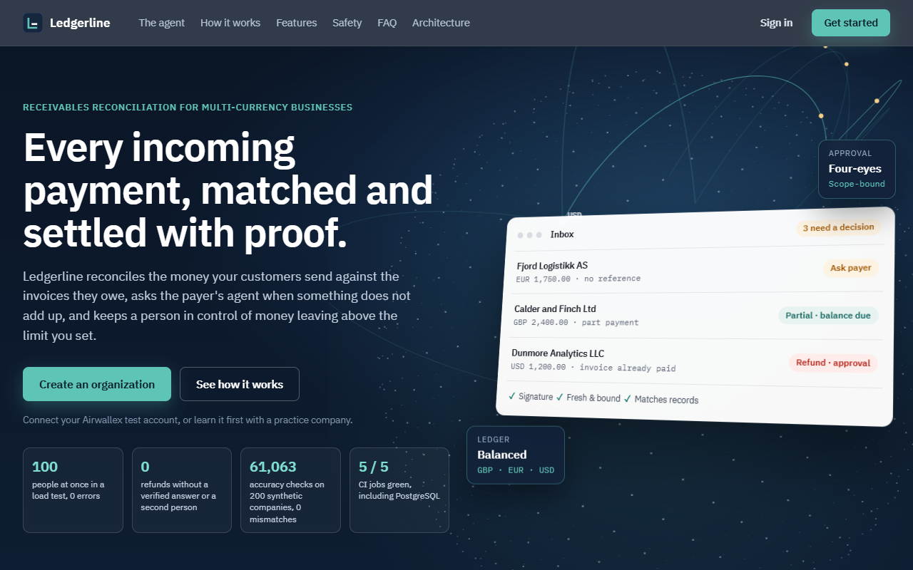 | 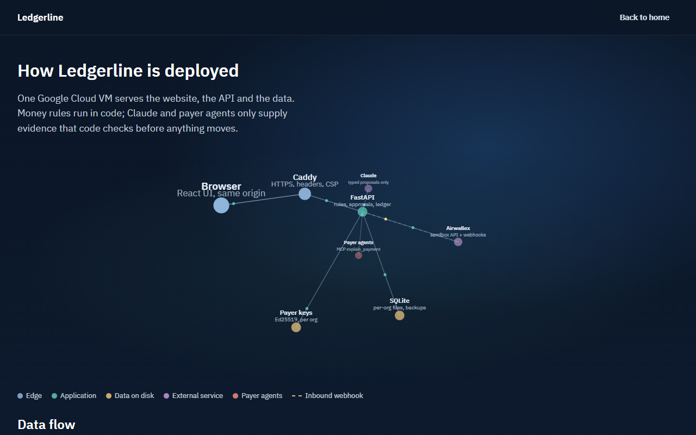 |
| 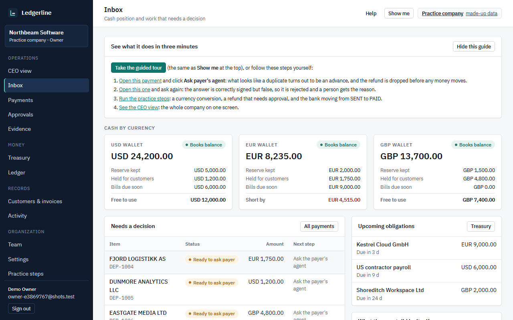 |  |
|  | 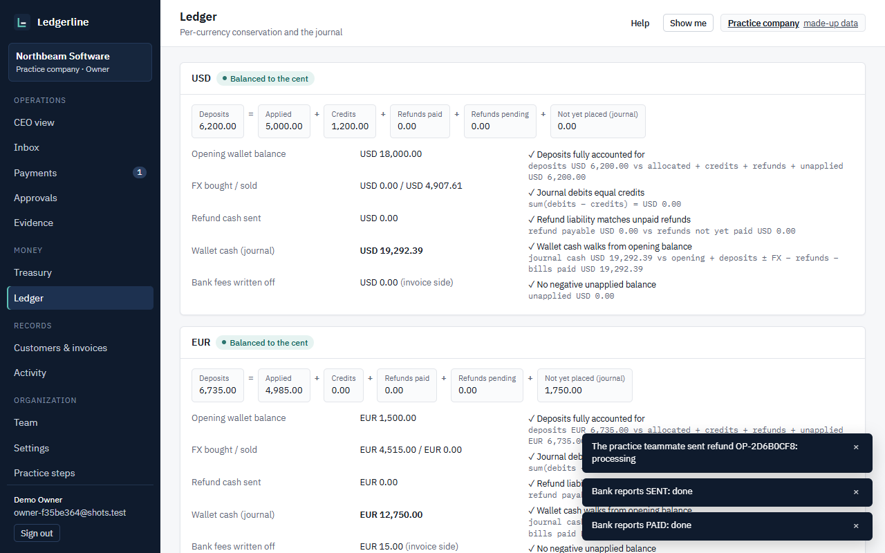 |
| 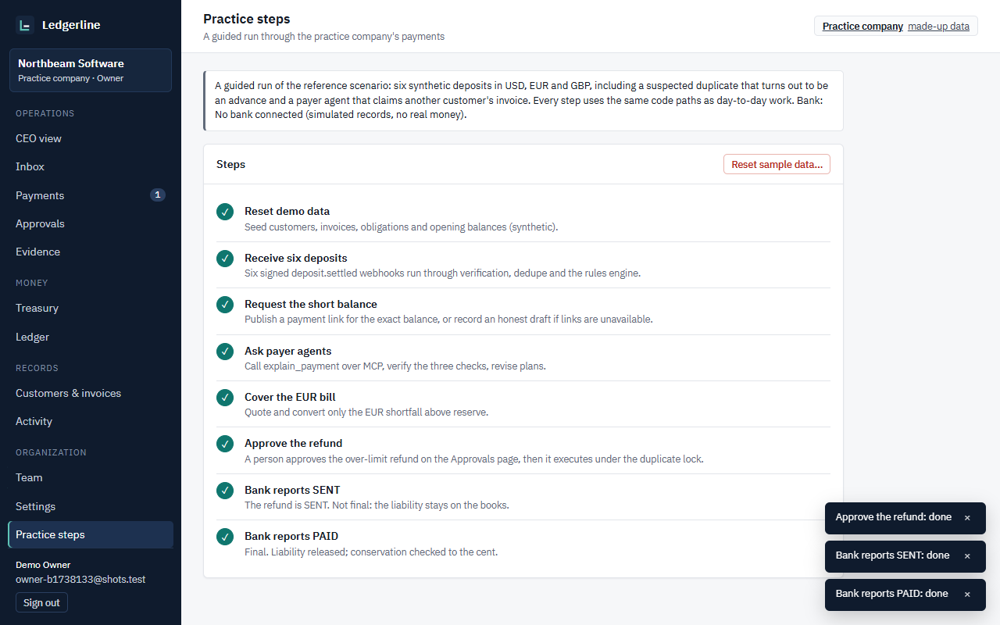 | 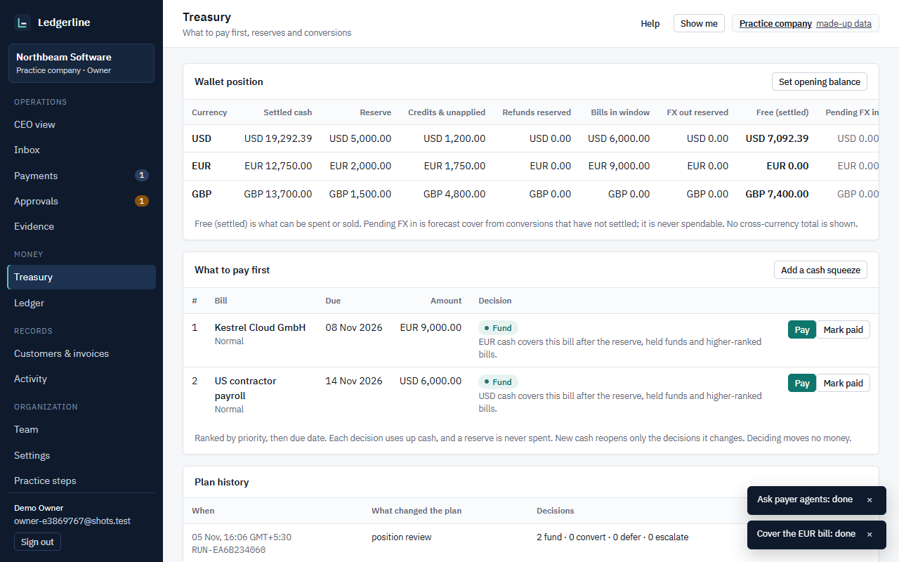 |

<sub>Captured from a real run on a synthetic company (`frontend/e2e/screenshots.spec.ts`). Desktop and 375 px layouts; every page meets WCAG AA contrast.</sub>

---

## 🧰 Tech stack

| Layer | Choice | Why |
|:--|:--|:--|
| API | Python 3.13+ (CI on 3.13 and 3.14), FastAPI, Pydantic | Typed request bodies; money in integer minor units only |
| Storage | SQLite per company (WAL); PostgreSQL 17 supported | One file per company is simple isolation; PostgreSQL runs the same tests in CI |
| Agents | MCP (Model Context Protocol), Ed25519 signatures | Payer agents answer a typed tool; answers are signed claims, checked three ways |
| AI | Claude (`claude-opus-5-5`), typed tools only | Reads remittance emails and PDFs; no tool can state an amount or an account |
| Bank | Airwallex sandbox API, signed webhooks | Deposits, refunds, conversions, bill payments, payment links, live rates |
| Web | React 18, TypeScript, Vite | One page app served by the API, no separate frontend host |
| Tests | pytest, Playwright (Edge, Chromium), GitHub Actions | Backend on Linux, Windows and PostgreSQL; the judge path in a real browser |
| Hosting | Google Cloud VM, Caddy (HTTPS), systemd | Nightly backups, hardening scripts, a separate sending service for the bank keys |

## 📁 Project layout

```text
backend/ledgerline/      the app: matching.py (rules), reconcile.py (plans and evidence), payouts.py (approvals, refunds),
                         evidence.py (the three checks), replay.py, audit.py (hash chain), treasury.py, agent_loop.py,
                         claude_reader.py, explain.py, payer_agents/ (MCP server and client), providers/ (bank), api/
backend/tests/           pytest suite, including the accuracy harness and the PostgreSQL tests
frontend/src/            React app: views/ (Inbox, Payments, Approvals, CEO view, ...), components/ (Show me, agent panel)
frontend/e2e/            Playwright tests: the whole judge path, phone width, the tour and the decision receipt
tools/payer_agent/       reference payer agent anyone can run with their own key
deploy/vm/               server setup, update, hardening, backups and the sending service
docs/                    judge quickstart and Q&A, payer agent spec, evidence and reports
scripts/                 accuracy run, evaluation, measured value, smoke tests
```

### Run the tests

```bash
cd backend && .venv/bin/python -m pytest -q
```

```bash
cd frontend && npm run e2e
```

PostgreSQL tests run when `LEDGERLINE_TEST_DATABASE_URL` points at a PostgreSQL 17 database (CI does this).

## 🧪 Run it yourself

<details>
<summary><b>Locally (Python 3.13+, Node 22.12+)</b></summary>

Linux or macOS:

```bash
python3 -m venv backend/.venv && backend/.venv/bin/pip install --require-hashes -r backend/requirements-lock.txt
```

```bash
(cd frontend && npm ci && npm run build)
```

```bash
cd backend && .venv/bin/python -m ledgerline
```

Windows:

```bash
powershell -ExecutionPolicy Bypass -File scripts/setup.ps1
```

```bash
powershell -ExecutionPolicy Bypass -File scripts/start.ps1
```

Open http://127.0.0.1:8000 → **Create an organization**. No default accounts. Data lives in `backend/var/`.

```bash
powershell -ExecutionPolicy Bypass -File scripts/test.ps1
```

```bash
backend\.venv\Scripts\python scripts\evaluate.py --seeds 50
```
</details>

<details>
<summary><b>Configuration (all optional)</b></summary>

| Variable | Purpose |
|:--|:--|
| `AIRWALLEX_CLIENT_ID`, `AIRWALLEX_API_KEY` | Airwallex sandbox (server-wide). Companies can instead connect their own keys under Settings |
| `LEDGERLINE_SANDBOX_ORGS` | the only organizations allowed to use them |
| `ANTHROPIC_API_KEY` | Claude reader (`claude-opus-5-5`, daily budgets per organization and server) |
| `GOOGLE_CLIENT_ID`, `GOOGLE_CLIENT_SECRET` | Sign in with Google |
| `LEDGERLINE_PUBLIC_URL`, `LEDGERLINE_ALLOWED_ORIGINS`, `LEDGERLINE_COOKIE_SECURE`, `LEDGERLINE_TRUSTED_PROXY_HOPS` | public origin, CSRF allow-list, secure cookie, proxy hops |
| `LEDGERLINE_WATCH_SECONDS` | how often connected accounts are checked for paid links (default 120, 0 turns it off) |
| `LEDGERLINE_DATA_DIR`, `LEDGERLINE_REQUIRE_PERSISTENT_MOUNT` | data location and a guard against ephemeral storage |

Without keys the app runs fully on the simulated bank and labelled offline rules.
</details>

<details>
<summary><b>Deploy, back up, troubleshoot</b></summary>

```bash
sudo bash deploy/vm/setup.sh <host> self <commit>
```

```bash
sudo bash /opt/ledgerline/src/deploy/vm/update.sh <commit>
```

Caddy (automatic HTTPS) → systemd service as an unprivileged user → SQLite on the persistent disk. A nightly timer makes consistent backups (7 kept); an isolated restore test passed. `scripts/smoke_deploy.py <url> --save/--verify` checks 32 behaviours and proves persistence across restart, reboot and redeploy. Full guide, backup/restore and troubleshooting table: [DEPLOYMENT](docs/DEPLOYMENT.md).
</details>

---

## 📚 Documents

| For | Read |
|:--|:--|
| Judges | [JUDGE_QUICKSTART](docs/JUDGE_QUICKSTART.md) · [JUDGE_QA](docs/JUDGE_QA.md) · [DEMO_SCRIPT](docs/DEMO_SCRIPT.md) |
| Evidence | [INTEGRATION_EVIDENCE](docs/INTEGRATION_EVIDENCE.md) · [EVALUATION](docs/EVALUATION.md) · [ACCURACY_REPORT](docs/ACCURACY_REPORT.md) · [MEASURED_VALUE](docs/MEASURED_VALUE.md) |
| Payer agents | [PAYER_AGENT_SPEC](docs/PAYER_AGENT_SPEC.md) · [JSON schema](docs/schemas/explain_payment.v1.schema.json) · [test vector](docs/schemas/explain_payment.v1.example.json) · [reference agent](tools/payer_agent/agent.py) |
| Acceptance | [FULL_APPLICATION_ACCEPTANCE_REPORT](docs/FULL_APPLICATION_ACCEPTANCE_REPORT.md) · [HACKATHON_REQUIREMENTS_MATRIX](docs/HACKATHON_REQUIREMENTS_MATRIX.md) |
| Operations | [DEPLOYMENT](docs/DEPLOYMENT.md) · [DEPLOYMENT_HANDOFF](docs/DEPLOYMENT_HANDOFF.md) |
| Origin | [Accepted proposal](docs/original-proposal.txt) · [SUBMISSION_DRAFT](docs/SUBMISSION_DRAFT.md) |

## ⚠️ Honest limits

- The built-in payer agents are simulations: real MCP and signatures, but answers come from a fixed table and keys sit on this server. A customer can register its own agent's address and public key (Customers → Payer agent…, Owner only); no outside company runs one yet. Check 3 tests plausibility against your records; it cannot tell a real advance from a false one that fits.
- Airwallex hosted payment links depend on the account's region. A Singapore sandbox account created a real hosted link on 2 Nov and it was paid with a test card; Ledgerline asks Airwallex every two minutes rather than using link webhooks, and settlement timing is not tracked. The earlier account was refused with `configuration_error`, and there Ledgerline keeps a labelled draft and never invents a URL.
- Airwallex's dashboard replay did not produce a second delivery, so duplicate rejection is proven by tests.
- USD, EUR and GBP only; other currencies are not supported yet.
- Invoice numbers are Ledgerline's own (INV-2301, INV-2302, ...). A payment that quotes another system's number (say HL-2026-014) is not matched by the rules or the remittance reader; a person places it with Resolve.
- One VM, backups on the same disk, Free Trial credit until 28 Jan 2027; no email delivery (invitation and reset links are copied by a person), no self-service password reset (an owner issues a one-hour link), no enterprise SSO or MFA, and no billing.
- The separate sending service ships switched off; the owner turns it on with server step 7. A compromised app could still request a send that its own database says was approved. Its Unix-socket test runs on Linux only and has not run while CI is blocked; on Windows it is tested over a loopback connection.

<p align="center"><sub>Built for the Airwallex Agentic Banking Hackathon · sandbox and synthetic data only · no real money</sub></p>
